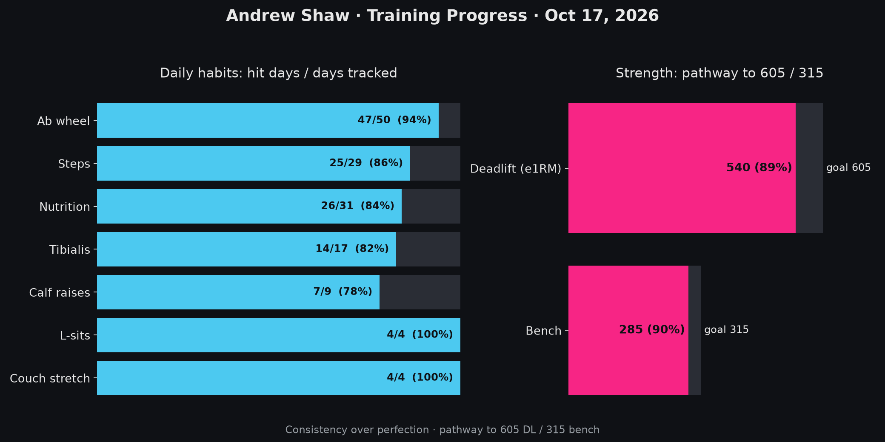

Good evening. It's Saturday the 17th of October, if you didn't know.

I wanted to share three ambient albums that I thoroughly enjoyed.

## 1. Deuter - D



What an incredible album! I was sifting through the ambient genre of rateyourmusic and stumbled upon this gem. 

It's listed under Krautrock, which is a "broad genre of experimental rock that developed in West Germany, in the late 1960s and 1970s." per Wikipedia. I have heard the term before. If it's anything like Sauerkraut, then we will be just fine.

I'm not so familiar with the artist, but it looks like Deuter's most popular album is Koyasan: Reiki Sound Healing. I'll have to give that one a listen sometime.

The album kicks off with a guitar-focused sound for the first two tracks. And then on Krishna Eating Fish and Chips, we hear some amazing new instruments that blend perfectly.

As the album begins to head towards the latter end, we get into this really cool noise/desolate sound. On Atlantis, as you could guess, we hear some rushing water, insects, birds all backed by a drum beat that's really inviting. I become an explorer on a wooden ship, cruising down the river of an unexplored area with high bushes and ferns that block any discovery of land beyond the water. I'm a bit biased, when I hear nature combined with synths, it's already my favorite.

The final track really brings it together, it feels like a continuation of Atlantis and it's just as great.

I really did not expect the album to kind of go from this guitar/rock-ish sort of sound to this anxiety-inducing sound, to this sort of closure feeling like a journey is wrapping up.

## 2. Jean-Jacques Perrey - Prélude au Sommeil



Deuter's album was apparently released in 1971, so I got curious - what were some of the first ambient/electronic albums?

That's where Jean's album comes to play. I knew from the first few minutes that I was really going to enjoy this album.

If you know me whatsoever, you know I'm a fan of progressive noise. I love a progressive build-up. Where noise seems to unwrap itself from a coil, explaining itself over time, but it needs that, time. It is not instantly gratifying. That's what makes it special.

I'm a sensitive person. Often to a fault. But, I believe the emotion in music might evoke a stronger reaction for me because of that sensitivity. I think this album really does that well. Maybe I long for a different time, focused on the tribulations of my "modern life", romanticizing a different time that appears simpler. We all every time period has it's issues.

Where I was I going with this..

Give it a listen. I can't write down the way it makes me feel. No vocabulary I know does it justice. Someone could describe this eloquently. I can't. It is beautiful. 

## 3. Rei Harakami - Unrest



I guess this one by definition doesn't pass as an Ambient album, I guess more electronic. And by Discogs definition - Electronic, Downtempo, and Breakbeat. But I include it none the less. It's got lots of different styles on here, nonetheless.

I'd go track by track but it isn't important to me. The album is so beautiful as this long listening experience. Like I said previously, the emotion that's drawn from my body here is surreal. There's nothing here I dislike, but I have some favorites.

On and unrest are so good. 

I wanted to include a picture of my fitness related streaks as an update!

